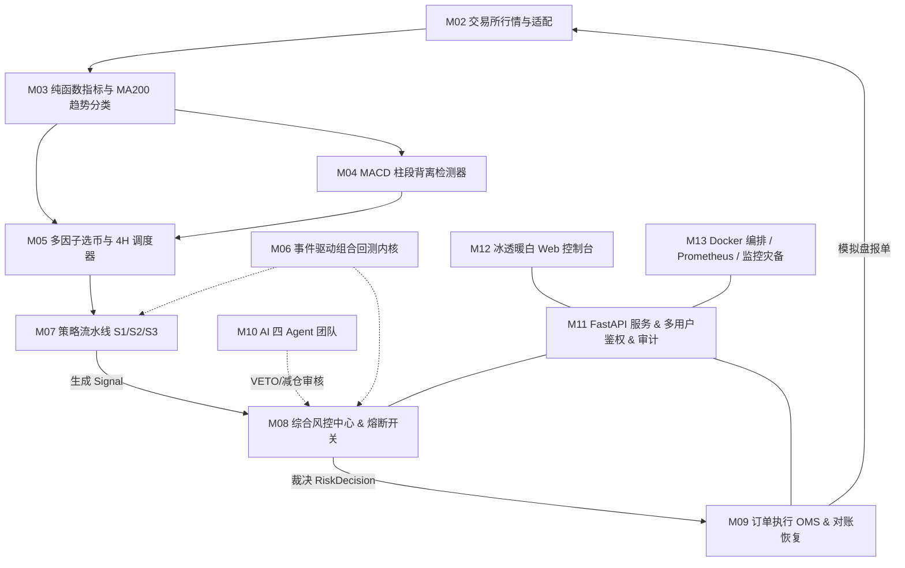

# DivergenceQuant

[-00F5A0.svg)](https://github.com/1535273240sch-droid/divergence-quant)
[](https://github.com/1535273240sch-droid/divergence-quant/tree/main/web/ice-console)
[](https://github.com/1535273240sch-droid/divergence-quant)
[](https://github.com/1535273240sch-droid/divergence-quant)

DivergenceQuant 是面向 OKX USDT 永续合约的高性能多币种量化交易与风险控制系统。

核心设计基于 **MACD 柱段背离检测**、**SMA200/EMA200 双轨趋势防抖分类**、**多因子动态选币**、**全事件驱动多币种回测内核**、**AI 协同多重避雷审阅** 以及 **三权分立安全交易执行与自动对账**。

> **当前系统版本**: `v0.3.0-alpha` (OKX 模拟盘、多用户账户、实时控制台与因子实验室整合版)
> **运行模式**: **OKX 模拟盘模式优先（严格禁止未经审核连接实盘）**  
> **详细版本说明**: 详见 [更新说明.md](./更新说明.md) 与 [未完成事项.md](./未完成事项.md)

---

## 模块架构全景



---

## 目录结构

```text
src/dquant/             正式 Python 业务包
  ├── contracts/        跨模块统一数据模型契约 (冻结)
  ├── core/             纯函数指标库、MA200趋势分类、MACD背离、选币初筛
  ├── adapters/         交易所统一适配器 (OKX模拟盘、限流、重试)
  ├── data/             K线补数、缺口修复、缓存、Binance归档解析
  ├── strategies/       S1顺势回调、S2震荡反转、S3逆势背离策略
  ├── backtest/         事件驱动多币种逐K线回测内核与自包含HTML报告
  ├── risk/             仓位计算、持仓/杠杆限制、BTC急跌熔断、AI否决/减仓
  ├── execution/        OMS订单状态机、clOrdId幂等、超时补单、对账恢复
  ├── ai/               OpenAI兼容多路由网关、四个专业Agent
  ├── api/              FastAPI服务、多用户鉴权、账户隔离、审计与WebSocket
  ├── notify/           邮件模板、滑动窗口限流、发件箱补发
  ├── scheduler/        4H收盘定时轮询调度、选币持久化
  ├── db/               TimescaleDB/SQLite ORM 模型
  └── settings.py       配置加载与安全门禁

web/                    冰透暖白静态前端控制台
  └── ice-console/      自包含 HTML/CSS/JS、图表库与字体

deploy/                 生产部署与运维配置
  ├── nginx/            生产级 Nginx 反向代理配置 (HTTPS/WSS/限流)
  ├── prometheus/       Prometheus 监控与 7 大业务告警规则
  ├── grafana/          运维总览看板
  └── postgres/         TimescaleDB 时序超表配置

scripts/                自动化运维与辅助工具
  ├── backfill.py       OKX 模拟盘历史 K 线补数
  ├── export_samples.py 背离信号真实 SVG 标注图批量渲染
  ├── calibrate_divergence.py 背离参数全自动网格调优
  ├── deploy.sh         安全发布流水线脚本
  ├── healthcheck.sh    全指标健康巡检脚本
  ├── backup.sh         AES-256-CBC 强加密全量备份
  └── restore.sh        签名校验与安全恢复演练脚本

tests/                  自动化 Python 测试套件 (462 项)
协作/                   各模块 HANDOFF 交付文档与验收记录 (M00～M13)
```

---

## 快速上手与验证

### 1. 环境准备
- Python 3.11 或更高版本
- Python 3.11+（后端与静态控制台预览）

### 2. 执行自动化测试
```bash
# 执行全部 Python 单元与集成测试 (当前基线 462 项)
pytest

# 执行代码风格与规范检查
ruff check src tests scripts
```

### 3. 启动冰透暖白控制台

当前前端是用户最近提交的自包含静态版本，不再保留旧 React/Vite 工程：

```bash
python -m http.server 8811 --directory web
# 浏览器打开 http://127.0.0.1:8811/ice-console/
```

要访问真实 `/api/v1`，请通过 Nginx/Docker Compose 同源提供前端和 API；直接使用
`file://` 只适合静态视觉预览。

### 4. 运行回测与报告生成
```python
from dquant.backtest import BacktestConfig, run_backtest, write_report
from dquant.strategies import S1TrendPullbackStrategy

# 初始化策略与回测配置，一键输出自包含交互式 HTML 回测战报
...
```

---

## 安全规则与红线

1. **敏感凭证绝不上库**：`.env`、API Key、密码、Token 严禁提交；用户 OKX 凭证按用户使用 Fernet 密文保存。
2. **默认模拟盘**：`LIVE_TRADING_CONFIRM` 环境变量默认必须为 `NO`，未通过 28 天模拟盘门禁考核前严禁开启实盘。
3. **资金安全第一**：GET 请求严禁产生任何交易动作；确认操作使用 HMAC-SHA256 一次性限时令牌。
4. **多用户隔离**：注册、登录、账户摘要和交易所凭证按 JWT 用户隔离；因子实验室为当前引擎共享配置。
