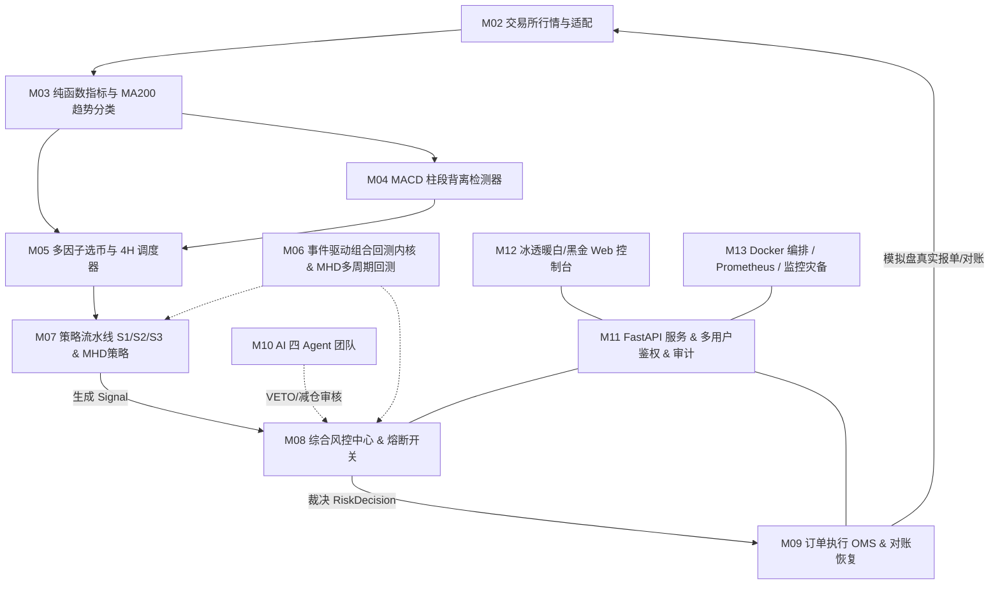

# DivergenceQuant

[-00F5A0.svg)](https://github.com/1535273240sch-droid/divergence-quant)
[](https://github.com/1535273240sch-droid/divergence-quant/tree/main/web/ice-console)
[](https://github.com/1535273240sch-droid/divergence-quant)
[](https://github.com/1535273240sch-droid/divergence-quant)

DivergenceQuant 是面向 OKX USDT 永续合约的高性能多币种量化交易与风险控制系统。

核心设计基于 **MACD 柱段背离检测**、**SMA200/EMA200 双轨趋势防抖分类**、**多因子动态选币**、**全事件驱动多币种回测内核**、**AI 协同多重避雷审阅** 以及 **三权分立安全交易执行与自动对账**。

> **当前系统版本**: `v0.4.0-alpha` (OKX 模拟盘真实开仓、多周期全量历史回测、ATR最优参数扫描与黑金控制台整合版)  
> **运行模式**: **OKX 模拟盘模式优先（严格禁止未经审核连接实盘）**  
> **详细版本说明**: 详见 [更新说明.md](./更新说明.md) 与 [未完成事项.md](./未完成事项.md)

---

## 模块架构全景



---

## 目录结构

```text
src/dquant/             正式 Python 业务包
  ├── contracts/        跨模块统一数据模型契约 (冻结)
  ├── core/             纯函数指标库、MA200趋势分类、MACD背离、选币初筛
  ├── adapters/         交易所统一适配器 (OKX模拟盘、限流、重试)
  ├── data/             K线补数、缺口修复、缓存、Binance归档解析
  ├── analytics/        MHD策略全量历史回测、ATR周期与倍数扫描、资金费率与滑点模拟
  ├── strategies/       S1顺势回调、S2震荡反转、S3逆势背离、MHD摆动点背离策略
  ├── backtest/         事件驱动多币种逐K线回测内核与自包含HTML报告
  ├── risk/             仓位计算、持仓/杠杆限制、BTC急跌熔断、AI否决/减仓
  ├── execution/        OMS订单状态机、clOrdId幂等、超时补单、对账恢复、真实模拟盘开平仓
  ├── ai/               OpenAI兼容多路由网关、四个专业Agent
  ├── api/              FastAPI服务、多用户鉴权、账户隔离、审计与WebSocket、MHD路由
  ├── notify/           邮件模板、滑动窗口限流、发件箱补发
  ├── scheduler/        4H收盘定时轮询调度、选币持久化、Engine执行守护
  ├── db/               TimescaleDB/SQLite ORM 模型
  └── settings.py       配置加载与安全门禁

web/                    前端控制台
  └── ice-console/      自包含 HTML/CSS/JS、图表库、K线MHD买卖点标注与因子实验室

deploy/                 生产部署与运维配置
  ├── nginx/            生产级 Nginx 反向代理配置 (HTTPS/WSS/限流/Gzip)
  ├── prometheus/       Prometheus 监控与 7 大业务告警规则
  ├── grafana/          运维总览看板
  └── postgres/         TimescaleDB 时序超表配置

scripts/                自动化运维与辅助工具
  ├── backfill.py       OKX 模拟盘历史 K 线补数
  ├── export_samples.py 背离信号真实 SVG 标注图批量渲染
  ├── calibrate_divergence.py 背离参数全自动网格调优
  ├── deploy.sh         安全发布流水线脚本
  ├── healthcheck.sh    全指标健康巡检脚本
  ├── backup.sh         AES-256-CBC 强加密全量备份
  └── restore.sh        签名校验与安全恢复演练脚本

tests/                  自动化 Python 测试套件 (473 项通过)
协作/                   各模块 HANDOFF 交付文档与验收记录 (M00～M13)
```

---

## 快速上手与验证

### 1. 环境准备
- Python 3.11 或更高版本
- 可选依赖：TA-Lib（非必须，系统已内置纯 Python 纯函数计算内核）

### 2. 执行自动化测试
```bash
# 执行全部 Python 单元与集成测试 (当前基线 473 项)
pytest -q

# 执行代码风格与规范检查
ruff check src tests scripts
```

### 3. 本地启动控制台预览
```bash
python -m http.server 8811 --directory web
# 打开 http://127.0.0.1:8811/ice-console/
```

### 4. 启动后端 API 与执行引擎
```bash
# 启动 API 服务
uvicorn dquant.api.main:app --host 0.0.0.0 --port 8000

# 启动量化执行引擎（OKX 模拟盘模式）
python -m dquant.scheduler.engine --source okx --execute --interval 30 --db data/engine.db
```
