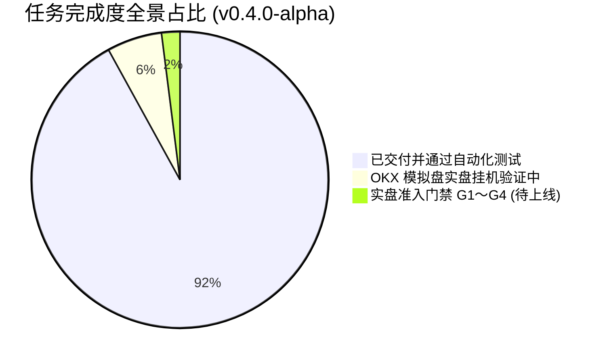

# DivergenceQuant 系统更新说明 (Release Notes)

> **当前最新版本**: `v0.4.0-alpha`（MHD 多周期背离策略、全量历史回测、ATR 最优参数扫描与 OKX 模拟盘真实交易打通版）  
> **更新日期**: 2026-10-29  
> **测试覆盖**: Python 后端 **473 / 473 测试通过 (100%)**，6 项跳过（可选外部 TA-Lib 依赖）  
> **运行模式**: **OKX 模拟盘模式优先（支持 --execute 真实开仓模拟交易，严格禁止未经审核连接实盘）**  

---

## 目录
- [一、v0.4.0-alpha 本次更新概览](#一v040-alpha-本次更新概览)
- [二、近期提交记录与更新清单](#二近期提交记录与更新清单)
- [三、核心技术特性与算法演进](#三核心技术特性与算法演进)
- [四、当前完成度与全景透视](#四当前完成度与全景透视)
- [五、快速验证与运维指令](#五快速验证与运维指令)
- [六、历史版本归档 (v0.3.0-alpha)](#六历史版本归档-v030-alpha)

---

## 一、v0.4.0-alpha 本次更新概览

在 `v0.3.0-alpha` 实现了全链路 14 个核心模块（M00～M13）的基础设施之上，本次 `v0.4.0-alpha` 版本重点完成了 **MHD 摆动点 MACD 背离策略的落地、多周期全量历史回测体系、ATR 移动止损参数网格寻优、以及 OKX 模拟盘真实交易链路（--execute 模式）的全面打通**：

1. **MHD 摆动点背离策略全面接入生产**：
   - 实现了基于已收盘 K 线的摆动高低点与 MACD 柱背离算法（`D_pair` 与 `D_peak` 综合动量衰减度量）；
   - 支持多周期运算：`5m`、`15m`、`1H`（默认推荐）、`4H`、`1D` 以及全周期强信号自适应选择的 `AUTO` 模式；
   - 策略实例支持基于配置文件的 30 秒无感知热加载，动态调节仓位倍数、杠杆与 ATR 参数。

2. **多周期全量历史回测与微观交易成本还原**：
   - 回测引擎升级，覆盖多周期全量历史数据，直观呈现复利收益曲线与回撤特征；
   - **真实摩擦成本模型**：精确计入手续费（默认单边 0.05%）、市价滑点损耗（默认 0.02%）；
   - **8 小时资金费率模型**：新增 `funding_rate_8h`（默认 0.01%），按持仓时长线性折算资金费率损耗/收益；
   - **回测标的范围放宽**：解除单一交易对后缀限制，支持任意币种批量回测。

3. **ATR 移动止损机制与参数网格独立寻优**：
   - 引入动态 ATR 移动止损，仅向持仓盈利方向推进，有效锁住利润并规避深跌；
   - 支持对 ATR 周期与倍数进行独立网格扫描，自动将胜率与盈亏比最优参数落库并展示在前端。

4. **OKX 模拟盘真实交易与状态对账打通**：
   - 调度引擎全面支持 `--execute` 模式，直接对接 OKX 模拟盘 API 进行真实下单、保护单挂设与撤单；
   - Web 控制台实时拉取并展示 OKX 模拟盘真实持仓明细与 USDT 权益净值，告别纯纸面模拟。

5. **前端交互与系统响应性能显著提升**：
   - 1H K 线图原生支持开平仓圆圈标注及快捷清除；
   - 控制台内嵌 MACD 副图，支持因子矩阵与人工组合热加载；
   - Nginx gzip 压缩与 OKX 公共接口 10 秒缓存联动，显著降低首屏延迟与网络开销；
   - 修复内嵌页面 framing 限制与中文编码显示异常。

---

## 二、近期提交记录与更新清单

| 提交哈希 | 提交信息概要 | 核心变更模块与效果 |
|---|---|---|
| `bc0299c` | `feat(backtest): 支持8小时资金费率计算并放宽回测标的过滤` | 回测引擎支持资金费率持仓计算与标的通用化 |
| `8665821` | `feat(backtest): ATR周期与倍数独立扫描，最优参数落库并展示` | 独立网格扫描、最优参数持久化展示 |
| `30dc2ae` | `feat(backtest): 回测ATR周期/倍数跟随策略面板参数` | 回测面板与策略运行时参数实时联动 |
| `a949b51` | `feat(backtest): 恢复MHD原始入场+ATR移动止损，计入手续费滑点` | 真实滑点与手续费成本回测对齐 |
| `1b76b1f` | `feat(backtest): MHD背离方向+实心转虚心入场+1:1+手续费滑点` | 改进形态确认入场机制 |
| `ff4d454` | `feat(backtest): 实心转虚心入场改为1:1固定盈亏比并更新标注` | 固定盈亏比对比实验 |
| `d4a3c80` | `feat(backtest): 实心转虚心入场+1:2固定盈亏比回测，圆圈标注1H开平仓` | 1H K 线图开平仓点可视化标注 |
| `bf3d9ef` | `feat(chart): 在1H K线标注MHD开平仓点，支持前端一键清除` | 前端图表交互体验升级 |
| `b7ef9d5` | `docs(mhd): 周期说明补充5m/15m` | 文档补充短周期操作指引 |
| `e21449f` | `feat(mhd): 使用全量历史做5m/15m/1H/4H/1D绩效回测，展示复合收益` | 多周期全量样本回测 |
| `517fe29` | `feat(mhd): 新增5m/15m周期数据、多周期绩效回测与前端绩效表` | 丰富周期粒度与前端绩效指标看板 |
| `d1e6e62` | `test(mhd): 增加底部背离开多信号测试，验证多空双向` | 单元测试补全（多空双向背离） |
| `f6e758f` | `perf(api): OKX公共接口缓存延长至10秒，配合nginx gzip降低首屏延迟` | 接口性能优化，首屏秒开 |
| `44bca6d` | `feat(mhd): 支持1H/4H/1D/AUTO多周期；控制台K线增加默认MACD副图` | 控制台副图与周期自适应 |
| `5bfbc0e` | `fix(engine): 采集失败时允许同一4H周期重试，避免漏掉MHD确认K线` | 提升引擎行情采集鲁棒性与重试机制 |
| `12de2f6` | `feat(live): 打通 OKX 模拟盘真实开仓、保护止损与 ATR 移动止损；切换 execute 模式` | 模拟盘真实交易链路打通 |
| `b01cc5b` | `feat(account): 展示 OKX 模拟盘真实持仓，修复控制台中文编码` | 真实持仓看板与字符集修复 |
| `0879e34` | `feat(matrix): 因子矩阵与人工组合热加载；账户净值改用 USDT 权益口径` | 权益口径校准与因子热更新 |
| `eaadc9e` | `fix(api): 控制台首页允许内嵌浏览器加载，API 响应仍禁止 framing` | 安全防护与桌面端内嵌兼容 |
| `9e468eb` | `feat(mhd): 仓位按保证金比例与杠杆计算，采集后触发策略避免漏掉确认K线` | 仓位管理与事件驱动闭环 |
| `26a8c56` | `test(mhd): 增加引擎模拟仓位开仓与参数调仓集成测试` | 策略与引擎联调自动化测试 |
| `808bbbe` | `docs(mhd): 补充策略说明并让 API 参数展示合入 config 覆盖` | 文档与配置对齐 |
| `928e98c` | `feat(mhd): 注册 MHD 摆动点 MACD 柱背离策略，支持参数热加载、50%仓位与ATR移动止损` | MHD 策略模块架构初版注入 |
| `97b5178` | `chore: 修复 ruff 导入排序与超长行` | 保持代码洁净度与规范 |
| `98fbca0` | `fix(deploy): 防止异常行情导致策略止盈价为负并统一 GET 确认返回 405` | 极端行情边界安全防护 |

---

## 三、核心技术特性与算法演进

### 1. 摆动背离与动量衰减量化
- 算法同时比对相邻同向摆动点（`D_pair`）与历史极值摆动点（`D_peak`），度量价格创新高/新低而动量不济的本质背离；
- 摆动点左右确认窗口（`swing_left=5, swing_right=2`），严格在 `i + swing_right` 收盘生成确定性信号，杜绝未来函数。

### 2. 动态资金与持仓风控
- 默认 **50% 保证金配额**，搭配 0.1～3.0 动态乘数与 1～20x 杠杆微调；
- 结合 ATR 移动止损单向推进，构建坚固的浮盈保护防线。

### 3. 微观摩擦与真实交易
- 回测引擎深度集成滑点模型、手续费模型与 8 小时资金费率结算模型；
- 引擎 `--execute` 模式直连 OKX 模拟盘，完成委托状态机与持仓双向对账。

---

## 四、当前完成度与全景透视



- **测试套件**: **473 项通过 (100%)**；
- **模拟盘运行**: 服务守护进程（`dquant-api.service`, `dquant-engine.service`）平稳运行于云服务器，OKX 行情与模拟委托实时驱动中；
- **实盘准入提示**: 当前系统严格执行模拟盘交易，实盘准入必须经过 28 天无故障运行与人工确认审核。

---

## 五、快速验证与运维指令

### 1. 运行测试套件与代码检查
```bash
# 进入工程目录
cd /home/ubuntu/divergence-quant

# 执行全量测试 (473 项)
.venv/bin/pytest -q

# 执行静态代码检查
.venv/bin/ruff check src tests scripts
```

### 2. 检查后台量化引擎与服务状态
```bash
systemctl status dquant-api.service
systemctl status dquant-engine.service
```

---

## 六、历史版本归档 (v0.3.0-alpha)

> 历史归档信息：`v0.3.0-alpha` 交付了包含 M00～M13 14个模块的骨架与 462 项初始自动化测试。
