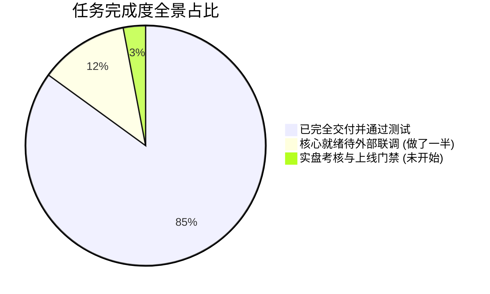

# DivergenceQuant 系统更新说明 (Release Notes)

> **发布版本**: `v0.2.0-alpha` (M00~M13 核心全模块整合与验收版)  
> **更新日期**: 2026-10-25  
> **测试覆盖**: Python 后端 **442 / 442 测试通过 (100%)**，Web 前端 **201 / 201 测试通过 (100%)**  
> **运行模式**: **OKX 模拟盘模式优先（严格禁止未经审核连接实盘）**

---

## 目录
- [一、本次更新概览](#一本次更新概览)
- [二、各模块完成清单与核心资产](#二各模块完成清单与核心资产)
- [三、核心技术特性与安全设计](#三核心技术特性与安全设计)
- [四、当前完成度：已完成 / 做了一半 / 待办事项](#四当前完成度已完成--做了一半--待办事项)
- [五、快速启动与测试验证指南](#五快速启动与测试验证指南)
- [六、后续推进路线与模拟盘考核](#六后续推进路线与模拟盘考核)

---

## 一、本次更新概览

本次更新完成了 DivergenceQuant 项目从骨架定义到 **全链路 14 个核心模块（M00～M13）** 的完整开发、算法对齐、测试验证与工程编排：

1. **工业级纯函数计算核心**：
   - 纯函数指标库实现（SMA, EMA, MACD, RSI, ATR, ADX），与 TA-Lib 对比误差小于 `1e-13`。
   - MA200 趋势分类器与 3 根 K 线连续防抖机制，杜绝未来函数。
   - MACD 柱段背离检测算法（常规/隐藏/二次背离链/早期预警），配套 0~100 分多因子评分体系。
   - A～F 候选池映射与多因子综合选币器（0.6 背离 + 0.3 趋势 + 0.1 流动性）。
2. **多币种事件驱动回测引擎**：
   - 逐 K 线推进、下一根开盘撮合，精确模拟 Maker/Taker 费率、不利滑点与资金费率。
   - 支持 Walk-Forward 样本外滚动优化与二维参数网格热力图分析。
   - 一键导出自包含交互式 HTML 回测战报。
3. **策略流水线与三权分立安全交易**：
   - S1 顺势回调背离、S2 震荡区间反转、S3 逆势背离（默认关闭）。
   - 风控中心（杠杆限制、持仓限制、BTC 熔断、日周亏损停止开仓、AI 否决/减仓、熔断人工解除）。
   - OMS 执行状态机（`clOrdId` 幂等、超时改市价补单、部分成交保护单、双向对账恢复锁与 HMAC 确认令牌）。
4. **AI 模型网关与专业 Agent 团队**：
   - 统一 OpenAI 兼容多路由网关（主备路由自动切换、Token/成本核算、每日预算熔断）。
   - 视觉二审、消息避雷（信源链审计）、一句话陪审、周度策略复盘调优四个专属 Agent。
5. **安全 API 与黑金美学控制台**：
   - FastAPI 路由、TOTP 双因素鉴权、防爆破锁定、GET 交易拦截（405 拦截）、审计脱敏与 WebSocket 广播。
   - Pure Black & Liquid Glass 黑金美学设计令牌底座、UI 组件库、AppShell 桌面及移动端响应式框架。
6. **生产级容器编排与灾备体系**：
   - 8 容器 Docker Compose 编排，生产 Nginx 反向代理与 Prometheus/Grafana 看板。
   - 安全发布、健康巡检、AES-256 加密备份与灾难恢复脚本（RTO ≤ 30min, RPO ≤ 24h）。

---

## 二、各模块完成清单与核心资产

| 模块 | 模块名称 | 核心文件路径 | 核心能力与关键接口 | 测试通过数 |
|---|---|---|---|:---:|
| **M00** | 架构骨架与公共契约 | `src/dquant/contracts/` | 冻结全部跨模块公共模型与枚举 (`models.py`, `types.py`) | 4 项 |
| **M01** | 基础设施与数据库 | `src/dquant/settings.py`, `db/` | 配置安全加载、TimescaleDB/SQLite ORM 模型、Alembic 迁移、Redis 边界 | 7 项 |
| **M02** | 交易所适配与行情 | `src/dquant/adapters/`, `data/` | OKX 模拟盘适配器、令牌桶限流、指数退避、K线增量/补数、Binance 归档解析 | 76 项 |
| **M03** | 指标库与趋势分类 | `src/dquant/core/indicators.py`, `regime.py`, `universe.py` | 纯函数 TA 指标库、SMA200/EMA200 双轨趋势与 3 根防抖、币池初筛 | 126 项 |
| **M04** | 背离检测与校准 | `src/dquant/core/divergence.py`, `pivots.py`, `scripts/` | MACD 柱段背离、隐藏/二次背离、早期提示、评分、SVG 导出与真实网格调参 | 43 项 |
| **M05** | 选币器与调度系统 | `src/dquant/core/screener.py`, `scheduler/` | A～F 候选池映射、0.6/0.3/0.1 打分、Top N 排序、持久化表与 4H 定时调度 | 64 项 |
| **M06** | 事件驱动回测引擎 | `src/dquant/backtest/` | 逐 K 线撮合内核、真实滑点/费率、Walk-Forward 优化、参数扫描、HTML 交互报告 | 48 项 |
| **M07** | 策略框架与 S1/S2/S3 | `src/dquant/strategies/` | S1 顺势、S2 震荡、S3 逆势（默认关闭）、策略基类/注册器/模板 | 14 项 |
| **M08** | 风险管理与紧急开关 | `src/dquant/risk/` | Decimal 仓位计算、杠杆/持仓上限、BTC 熔断、日周亏损停开仓、AI 减仓/否决、紧急开关 | 15 项 |
| **M09** | 订单执行 (OMS) 与对账 | `src/dquant/execution/` | OMS 状态机、clOrdId 幂等、超时补单、增量保护单、对账恢复锁、二次确认令牌 | 11 项 |
| **M10** | AI 网关与四个 Agent | `src/dquant/ai/` | OpenAI 兼容网关、视觉二审、消息避雷、一句话陪审、周度复盘调优 Agent | 11 项 |
| **M11** | API 服务、通知与鉴权 | `src/dquant/api/`, `notify/` | FastAPI、TOTP 双因素鉴权、防爆破锁定、GET 交易拦截 (405)、审计脱敏、WebSocket、邮件引擎 | 19 项 |
| **M12** | Web 控制台 (桌面/移动) | `web/src/`, `web/index.html` | Pure Black 设计令牌底座、UI 组件库、AppShell 响应式布局、命令面板 (Ctrl+K)、全功能原型 | 201 项 (Web) |
| **M13** | 生产部署与运维灾备 | `deploy/`, `scripts/` | Docker Compose (8容器)、生产 Nginx、Prometheus 告警规则、Grafana 看板、备份恢复脚本 | 6 项 |

---

## 三、核心技术特性与安全设计

### 1. 严格防未来函数与因果性
- 所有指标计算（SMA, EMA, MACD, RSI, ATR, ADX）严格遵循截断重算不变性；
- 背离信号与趋势分类只有在确认 K 线收盘时间（`confirmed_ts`）到达后才正式生效，回测中严禁使用未收盘价格撮合；
- 趋势分类引入连续 3 根 K 线的迟滞防抖（`debounce_states`），杜绝频繁震荡跳变。

### 2. 交易三权分立安全门禁
- **策略层 (M07)**：只负责从图表和数学模型中发现形态，输出意向 `Signal`，不具备下单权限；
- **风控层 (M08)**：统一审核仓位杠杆、最大持仓数、BTC 急涨急跌、日/周最大回撤以及 AI 审查结果，输出带有配额的 `RiskDecision`；
- **执行层 (M09)**：基于状态机和全局唯一 `clOrdId` 生成确定性委托，只有风控放行才进入交易所队列，并实时对账。

### 3. API 与资金安全红线
- **GET 请求严禁产生交易**：`GET /api/v1/signals/{id}/confirm` 强制返回 `405 Method Not Allowed`；
- **一次性确认下单令牌**：基于 HMAC-SHA256 签名，有效期限 15 分钟，单次消费防重放、防 CSRF；
- **敏感信息全面脱敏**：审计日志中自动将密码、Token、Secret 替换为 `******`，API Key 仅保留后 4 位。

---

## 四、当前完成度：已完成 / 做了一半 / 待办事项



### 1. 已做完并验收通过 (100% 单元/集成测试)
- M00 契约与骨架
- M01 基础设施与配置
- M03 纯函数指标库与 MA200 趋势分类
- M04 背离检测核心、SVG 导出与网格校准
- M05 选币器与 4H 调度系统
- M06 事件驱动回测引擎与全功能交互报告
- M07 策略框架（S1/S2/S3）
- M11 FastAPI 服务、鉴权、通知与审计
- M13 容器编排、监控告警与备份恢复脚本

### 2. 核心就绪、待进一步联调 (做了一半)
- **M02 / M09 模拟盘实机联调**：OKX 适配器与 OMS 核心已通过所有 Mock 验证，待配置真实模拟盘 API Key 进行公网挂机；
- **M10 AI 外部信源绑定**：模型网关与 4 个 Agent 架构就绪，待填入生产大模型 Key 和外部新闻爬虫源；
- **M12 Web 前端页面交互**：设计令牌、UI 库、AppShell 与快捷键已通过 201 项测试，各业务子页面待从“占位态”接入后端真实 API 数据渲染。

### 3. 完全未开始 / 待办事项 (需环境与用户配合)
- **端到端单一主入口组装**：后续编写守护进程脚本一键拉起全链路主循环；
- **OKX 模拟盘 28 天无故障运行考核**；
- **实盘准入门禁 G1～G4**（在此之前严禁连接任何实盘账户）。

---

## 五、快速启动与测试验证指南

### 1. 运行后端全量测试
```bash
# 运行全部 442 项 Python 单元与集成测试
pytest -q

# 执行代码风格与规范检查
ruff check src tests scripts
```

### 2. 运行前端全量测试
```bash
cd web
npm test
# 或执行类型检查与代码检查
npx tsc --noEmit
npm run build
cd ..
```

### 3. 本地启动控制台预览
- **增强版全功能原型**：直接双击或使用浏览器打开 [web/index.html](file:///e:/加密货币量化/web/index.html)；
- **现代化 React 控制台**：
  ```bash
  cd web
  npm run dev
  # 打开浏览器访问控制台验收页：http://localhost:5173/console.html
  ```

### 4. 运行历史行情补数与背离校准脚本
```powershell
# 运行 OKX 模拟盘历史补数
py scripts/backfill.py --inst-id ETH-USDT-SWAP --bar 4H --days 30 --dry-run

# 运行背离样本导出
py scripts/export_samples.py --input tests/fixtures/synthetic_candles_4h.csv --output-dir reports/samples

# 运行背离参数自动网格校准
py scripts/calibrate_divergence.py --golden tests/fixtures/golden_divergences.csv --output reports/calibration_report.md
```

---

## 六、后续推进路线与模拟盘考核

1. **第一阶段（当前）**：全模块核心实现交付，代码库全部整理推送到 GitHub 远程仓库，测试全绿；
2. **第二阶段**：编写主进程启动器，接入用户模拟盘 API Key，开启 4H 自动选币、信号推送与模拟盘自动下单；
3. **第三阶段**：Web 控制台子页面接入后端实时 WebSocket 与 REST 数据；
4. **第四阶段**：模拟盘连续挂机 28 天，验证信号一致率、零漏单与对账完整性；
5. **第五阶段**：通过 G1～G4 门禁后，由用户人工确认是否上线实盘。
