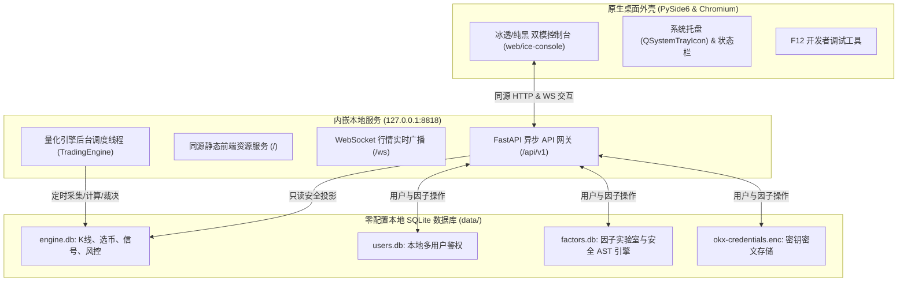

# DivergenceQuant / CHRONO QUANT 桌面端量化交易系统使用指南

## 一、系统架构总览（全集成三合一版）

本项目基于 GitHub 仓库最新版本（2026-10-29，桌面端 `v1.1.0`），专为桌面单机运行深度重构与整合：



---

## 二、双模主题系统（纯黑液态玻璃 & 冰透银白）

系统内置两套高定金融级界面主题，满足不同光线环境与交易习惯：

1. **极致纯黑战情室 (Obsidian & Liquid Glass)** —— **默认主题**
   - **设计基调**：核心画布、全局背景采用 **极致纯黑 `#000000`**（OLED 级深邃科技质感）。
   - **毛玻璃与高光**：半透明微透物理毛玻璃（`rgba(18, 22, 28, 0.65)` + `backdrop-filter: blur(20px)`），搭配 `1px` 白金微折射高光边框。
   - **高定金融配色**：翡翠霓虹绿 `#00F5A0`（多头/上涨/做多）、霓虹绯红 `#FF4D5E`（空头/下跌/做空）、钻石纯白 `#FFFFFF` 与钛金冷灰 `#CBD5E1`。

2. **冰透银白暖白模式 (Ice Glass Mode)** —— **仓库原版 100% 还原**
   - 严格保留您在最新提交中的原版视觉（背景采用冰透银白暖白质感 `#ece5d9` / `#FAF9F6`）。
   - 布局、功能、按钮、组件完全原汁原味。

### 主题切换方式
- **方式一**：在界面右上角点击 **「纯黑战情 / 冰透银白」** 按钮，一键即时切换。
- **方式二**：在键盘上随时按下快捷键 <kbd>T</kbd>（无输入框聚焦时）即可毫秒级平滑切换。
- **自动记忆**：系统自动将您选定的主题持久化保存，下次启动桌面软件时自动保持。

---

## 三、快速启动指南

### 1. 安装版（推荐）

1. 从 GitHub **Releases** 下载 `DivergenceQuant-Setup-1.1.0-x64.exe`；
2. 双击安装，按当前用户安装到 `%LOCALAPPDATA%\Programs\DivergenceQuant`，无需管理员权限；
3. 安装完成后从开始菜单或桌面快捷方式启动 `DivergenceQuant`；
4. 首次启动会在安装目录的 `data/` 下初始化 SQLite 数据库和 JWT 密钥。

卸载时通过“设置 → 应用”或开始菜单中的卸载入口操作；卸载器会保留 `data/` 数据库，重新安装后可继续使用。

### 2. 便携版

1. 下载 `DivergenceQuant-1.1.0-Windows-x64.zip`；
2. 解压到任意可写目录（不要直接放在只读目录或压缩包预览中运行）；
3. 双击 `DivergenceQuant.exe` 或 `启动DivergenceQuant.bat`；
4. 所有运行数据保存在解压目录的 `data/` 内，整个目录可直接拷贝到其他 Windows 电脑使用。

> 安装包未做代码签名，首次运行可能出现 Windows SmartScreen“未知发布者”提示；请先用 Release 中的 `SHA256SUMS.txt` 校验文件，再选择“仍要运行”。

### 3. 源码启动（开发调试）

```bash
# 进入项目目录并启动桌面客户端
py desktop_app.py

# 启动时指定参数（可选）：
# --port 8818          指定内嵌服务端口（默认 8818）
# --engine synthetic   以离线合成行情模式启动引擎（安全无网络冒烟）
# --engine okx         以 OKX 公开行情模式启动引擎（采集真实行情）
# --no-engine          仅启动前端与 API，不自动启动引擎采集
```

### 4. 数据与日志位置

- 安装版/便携版：软件目录下的 `data/`；
- 源码运行：仓库根目录下的 `data/`；
- 启动日志：软件目录下的 `desktop_debug.log`（排查启动问题时查看）；
- 备份：退出软件后复制整个 `data/` 目录即可，恢复时覆盖回原位置。

---

## 四、核心功能使用引导

### 1. 账户注册与登录
- 初次使用点击右上角 **「登录 / 注册」**；
- 输入用户名与密码即可注册本地账户（密码采用加盐 PBKDF2 安全存储，不保存明文）；
- 登录后点击右上角头像打开 **「账户与交易所」** 抽屉，绑定您的 OKX 模拟盘 API Key（密钥经 Fernet 强加密保存在本地 `data/okx-credentials.enc`，绝不外泄）。

### 2. 选币与信号监控
- 顶栏实时显示 BTC / ETH / SOL 实时行情；
- 左侧面板查看账户资产与策略矩阵（S1 顺势回调、S2 震荡反转、S3 逆势背离）；
- 中间区域展示 K 线全屏交互图表与 MACD 柱段背离标记；
- 底部显示盘口委托单簿（60 FPS 增量更新）与逐笔成交。

### 3. 因子实验室 (Factor Lab)
- 点击右上角 **「因子」** 打开因子实验室；
- 可自定义动量、波动率或均线因子公式（如 `zscore(close, 20)`）；
- 内置沙箱级 AST 安全校验，支持一键实时计算预览。

### 4. 快捷键一览
- <kbd>⌘K</kbd> / <kbd>Ctrl+K</kbd>：唤出全局搜索与命令面板
- <kbd>T</kbd>：在 **纯黑战情室** 与 **冰透银白暖白** 之间切换
- <kbd>F12</kbd>：打开/关闭 Chromium 开发者调试工具
- <kbd>Esc</kbd>：关闭当前弹窗或抽屉
