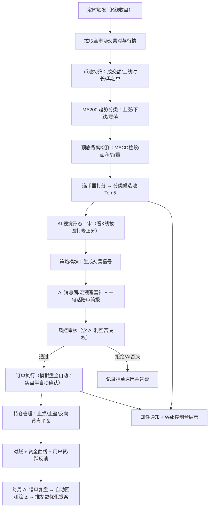
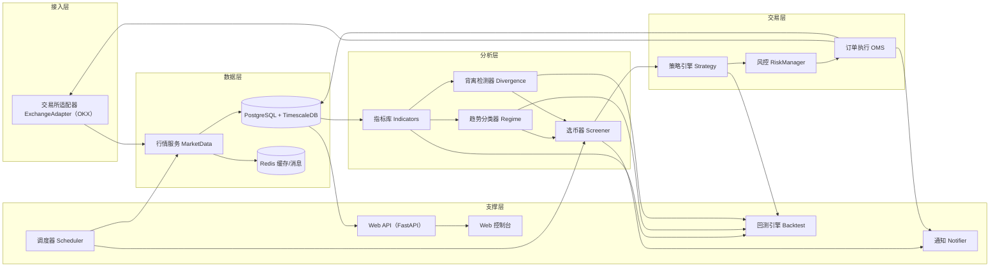
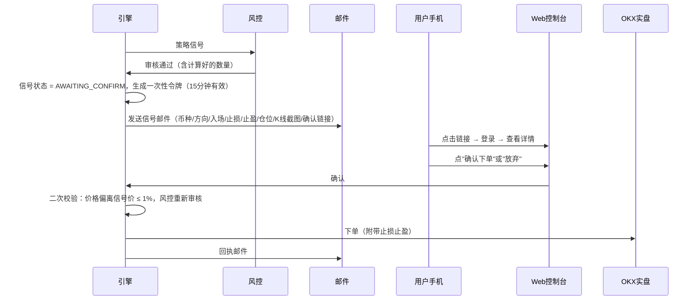
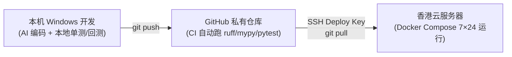

# 加密货币量化交易系统 —— 项目执行计划书（V1.4 完整执行版）

> **项目代号**：`DivergenceQuant`（背离量化）
> **文档版本**：V1.4（完整执行版；已纳入策略、AI、手机端、监控、备份、灾难恢复及安全运维决策，最终决策汇总见 §15）
> **文档用途**：作为交付给 AI 开发代理（Codex / CatPaw / Claude 等）执行的**唯一权威规格说明**。所有实现必须以本文档为准，冲突时以本文档最新版本为准。
> **交易所**：OKX（欧易）—— 先模拟盘（Demo Trading），后小资金实盘
> **部署形态**：云服务器（Linux + Docker Compose）7×24 小时无人值守运行

---

## 目录

1. [项目概述](#1-项目概述)
2. [业务流程总览](#2-业务流程总览)
3. [系统架构设计](#3-系统架构设计)
4. [技术选型](#4-技术选型)
5. [模块详细设计](#5-模块详细设计)
   - 5.1 交易所适配层
   - 5.2 行情数据层
   - 5.3 指标计算库
   - 5.4 币池初筛（Universe）
   - 5.5 趋势状态分类器（MA200 Regime）
   - 5.6 顶底背离检测器
   - 5.7 选币器（Screener）与评分
   - 5.8 策略框架（可插拔，预留自定义）
   - 5.9 回测引擎
   - 5.10 订单执行引擎
   - 5.11 风险管理
   - 5.12 通知与告警
   - 5.13 Web 控制台
   - 5.14 AI 大模型研判与策略进化引擎
6. [策略建议（可选启用）](#6-策略建议可选启用)
7. [数据库设计](#7-数据库设计)
8. [配置文件规范](#8-配置文件规范)
9. [目录结构](#9-目录结构)
10. [云服务器部署方案](#10-云服务器部署方案)
11. [安全规范](#11-安全规范)
12. [测试与验收](#12-测试与验收)
13. [实施阶段与任务拆解（AI 执行清单）](#13-实施阶段与任务拆解ai-执行清单)
14. [风险清单与应对](#14-风险清单与应对)
15. [决策记录与待办事项](#15-决策记录与待办事项)
16. [附录](#16-附录)
17. [前端 UI/UX 设计规范](#17-前端-uiux-设计规范)

---

## 1. 项目概述

### 1.1 项目背景

当前交易方式为手工盯盘：以 **MA200** 判断大趋势，结合 **顶背离 / 底背离** 寻找入场点。手工方式存在以下痛点：

| 痛点 | 说明 |
|---|---|
| 覆盖面窄 | OKX 上数百个交易对，人工无法同时观察 |
| 主观性强 | 背离的识别标准每次不一致，难以复盘 |
| 时效性差 | 背离信号常在凌晨出现，人工错过 |
| 无法验证 | 没有历史回测数据证明方法的胜率与盈亏比 |
| 执行纪律 | 止损止盈依赖人工，容易情绪化 |

### 1.2 项目目标

构建一套**部署在云服务器上、7×24 小时自动运行**的量化系统，实现：

1. **自动选币**：对 OKX 全市场交易对进行初筛 → 用 MA200 判定每个币处于【上涨 / 下跌 / 震荡】→ 检测是否出现【顶背离 / 底背离】→ 输出分类候选池。
2. **自动跑策略**：对候选池中的币运行可插拔的策略模块（第一版提供建议策略，用户后续可自行替换/新增）。
3. **自动交易**：通过 OKX API 下单，**第一阶段只连接模拟盘**，验证稳定后切换实盘。
4. **风险控制**：单笔风险、总仓位、日亏损、最大回撤多级风控，触发自动熔断。
5. **可视化与通知**：Web 控制台查看选币结果、K 线与背离标注、持仓、收益曲线；关键事件推送到手机。
6. **可回测**：所有选币与策略逻辑都可在历史数据上回测，**回测与实盘共用同一份信号代码**。

### 1.3 项目范围

| 范围内（In Scope） | 范围外（Out of Scope，完整版本不做） |
|---|---|
| OKX 单交易所 | 多交易所套利 |
| **USDT 本位永续合约**（可做多做空，已确认） | 现货、期权、币本位合约 |
| K 线级别策略（15m ~ 1D） | 高频 / 盘口做市 |
| 模拟盘 → 小资金实盘 | 代客理财、多用户 SaaS |
| 单用户 Web 控制台 + 手机端 Web 精简控制台 | 原生 iOS / Android App |

### 1.4 成功标准（KPI）

| 编号 | 指标 | 目标值 |
|---|---|---|
| K1 | 系统可用性（模拟盘运行期） | ≥ 99%（每月宕机 < 7 小时） |
| K2 | 选币全市场扫描耗时 | ≤ 60 秒 / 轮（约 300 个交易对） |
| K3 | 信号到下单延迟 | ≤ 5 秒（K 线收盘后） |
| K4 | 回测与模拟盘信号一致率 | ≥ 95%（同一时间段对比） |
| K5 | 订单状态对账差异 | 0（每日对账） |
| K6 | 模拟盘连续稳定运行 | ≥ 4 周无人工干预 |
| K7 | 背离识别与人工判断一致率 | ≥ 80%（用户抽查 50 个样本） |

---

## 2. 业务流程总览



**多周期分工（默认值，可配置）**：

| 用途 | 默认周期 | 说明 |
|---|---|---|
| 大趋势判定（MA200 Regime） | **1D（日线）** | 决定"只做多 / 只做空 / 双向"方向 |
| 背离检测（主信号） | **4H** | 选币的核心信号周期 |
| 入场触发 / 精细止损 | **1H** | 背离确认后在小周期找触发点 |

> [!NOTE]
> 已确认采用"日线趋势 / 4H 背离 / 1H 触发"。周期全部写在配置里，以后想换只改配置，不改代码。

**执行模式（已确认）**：

| 环境 | 模式 | 说明 |
|---|---|---|
| OKX 模拟盘 | **全自动** | 信号经风控审核后直接下单 |
| OKX 实盘（初期） | **半自动** | 系统生成信号 → 邮件通知（附一次性确认链接）→ 用户在手机浏览器打开 Web 控制台确认 → 才下单；超过有效期（默认 15 分钟）未确认自动作废 |
| OKX 实盘（后期） | 全自动（可选） | 半自动运行稳定、用户手动切换后 |

---

## 3. 系统架构设计

### 3.1 逻辑架构



### 3.2 核心架构原则

1. **信号代码唯一化**：指标、趋势分类、背离检测、策略信号全部写在纯函数库 `core/` 中，**回测、选币、实盘调用同一份代码**，禁止复制粘贴两套逻辑。
2. **无未来函数**：所有计算只使用"已收盘 K 线"；背离的枢轴点（Pivot）必须在右侧确认 K 线收盘后才可用（见 §5.6）。
3. **交易所解耦**：业务代码只依赖 `ExchangeAdapter` 抽象接口，后续接 Binance/Bybit 只需新增适配器。
4. **模拟/实盘一键切换**：通过配置 `exchange.mode: demo | live` 切换，且 live 模式需要额外的二次确认环境变量 `LIVE_TRADING_CONFIRM=YES`，防止误操作。
5. **幂等与可恢复**：所有订单使用自定义客户端订单号 `clOrdId`；进程重启后从数据库 + 交易所对账恢复状态，不重复下单。
6. **配置驱动**：参数（周期、阈值、风控）全部在 YAML 配置中，代码中禁止硬编码魔法数字。

### 3.3 进程/容器划分

| 容器 | 职责 | 重启策略 |
|---|---|---|
| `postgres` | 时序 K 线、信号、订单、资金曲线 | always |
| `redis` | 行情缓存、任务锁、实时推送 | always |
| `collector` | 行情采集（REST 补数 + WebSocket 实时） | always |
| `engine` | 调度器 + 选币 + 策略 + 风控 + OMS | always |
| `api` | FastAPI 后端 | always |
| `web` | 前端静态站点（Nginx） | always |
| `prometheus` | 指标采集与告警规则 | always |
| `grafana` | 系统、交易、风控与 AI 运行看板 | always |
| `backtest` | 按需运行的回测任务（不常驻） | no |

> [!IMPORTANT]
> `engine` 必须**单实例运行**（用 Redis 分布式锁保证），防止双进程重复下单。

---

## 4. 技术选型

| 类别 | 选型 | 理由 |
|---|---|---|
| 语言 | Python 3.11+ | 量化生态最成熟 |
| 交易所 SDK | `ccxt`（含异步与 WebSocket 能力）为主；`python-okx` 官方 SDK 作为备选 | ccxt 统一接口、支持 OKX 模拟盘 `set_sandbox_mode(True)`；OKX 特有功能（附带止盈止损 `attachAlgoOrds`）可直接调原生接口 |
| 数据处理 | `pandas`、`numpy`、`polars`（可选） | — |
| 指标 | **自研 numpy 实现** + `TA-Lib` 作为单元测试对照 | 避免第三方库停更风险，同时保证计算正确性 |
| 回测 | 自研事件驱动回测（主）+ `vectorbt`（参数批量扫描，可选） | 自研保证与实盘逻辑一致 |
| 调度 | `APScheduler`（AsyncIO） | 按 K 线收盘时间精准触发 |
| 数据库 | PostgreSQL 16 + TimescaleDB | K 线时序存储与压缩 |
| 缓存/锁 | Redis 7 | — |
| Web 后端 | FastAPI + Uvicorn + WebSocket | — |
| Web 前端 | React + Vite + TypeScript + TradingView `lightweight-charts` | K 线与背离标注渲染 |
| 日志 | `loguru`（JSON 结构化输出） | — |
| 配置 | `pydantic-settings` + YAML | 启动时强类型校验 |
| 通知 | **邮件（SMTP，唯一外部通知渠道）**；手机端通过邮件一次性链接进入 Web 控制台 | — |
| 监控 | Prometheus + Grafana | 容器、行情、订单、风控、AI 成本、数据库与主机指标 |
| 部署 | Docker + Docker Compose | — |
| 代码质量 | `ruff`、`mypy`、`pytest`、`pre-commit` | — |

---

## 5. 模块详细设计

### 5.1 交易所适配层（`adapters/`）

#### 5.1.1 抽象接口

```python
class ExchangeAdapter(Protocol):
    async def load_instruments(self, inst_type: str) -> list[Instrument]: ...
    async def fetch_tickers(self, inst_type: str) -> list[Ticker]: ...
    async def fetch_candles(self, inst_id: str, bar: str,
                            since: int | None, limit: int) -> list[Candle]: ...
    async def fetch_balance(self) -> Balance: ...
    async def fetch_positions(self) -> list[Position]: ...
    async def fetch_open_orders(self) -> list[Order]: ...
    async def place_order(self, req: OrderRequest) -> OrderAck: ...
    async def cancel_order(self, inst_id: str, cl_ord_id: str) -> None: ...
    async def set_leverage(self, inst_id: str, lever: int, mgn_mode: str) -> None: ...
    async def fetch_funding_rate(self, inst_id: str) -> FundingRate: ...
    async def subscribe_candles(self, inst_ids: list[str], bar: str, cb) -> None: ...
    async def subscribe_orders(self, cb) -> None: ...
```

#### 5.1.2 OKX 实现要点

| 项目 | 说明 |
|---|---|
| 模拟盘 | 需在 OKX 网页 → 交易 → **模拟交易** 模式下单独创建 **模拟盘 API Key**（与实盘 Key 不通用）；REST 请求头带 `x-simulated-trading: 1`；ccxt 中 `exchange.set_sandbox_mode(True)` |
| 模拟盘 WebSocket | 使用 OKX 模拟盘专用 WS 地址（`wspap.okx.com`），具体以 OKX 官方文档为准 |
| 交易对 | `GET /api/v5/public/instruments`（instType = SPOT / SWAP） |
| 行情 | `GET /api/v5/market/tickers`、`/market/candles`（近期）、`/market/history-candles`（历史）；**日线必须传 `bar=1D`，使用 UTC+8 开盘价 K 线，禁止传 `1Dutc`** |
| 下单 | `POST /api/v5/trade/order`，使用 `attachAlgoOrds` 在开仓时附带止盈止损 |
| 账户与隔离 | 实盘使用 **OKX 独立子账户**（与用户手工交易的主账户完全隔离）；启动时检查/设置持仓模式 `long_short_mode`（双向持仓）、保证金模式 **`isolated`（逐仓，已确认）**、`set-leverage` |
| 合约换算与小资金适配 | 永续合约下单单位是"张"，必须读取 `ctVal`（合约面值）、`lotSz`（最小下单步长）、`minSz`、`tickSz` 做精度处理；针对 **≤ 1,000 USDT 小资金**，若计算出的张数不足以拆成两半（`< 2 × lotSz` 或 `< 2 × minSz`），自动标记为 `single_tp_mode=True`（不分批止盈，改为触及 1R 移保本 + 整体单笔止盈） |
| 限频 | 严格遵守 OKX 各接口限频（以官方文档为准），适配器内置**令牌桶限流器**；收到 429 / `50011` 错误码时指数退避重试 |
| 时间同步 | 启动时校准服务器时间（`/api/v5/public/time`），签名时间戳偏差 > 1 秒告警 |
| 错误处理 | 统一封装为 `ExchangeError(code, msg, retriable: bool)`；网络超时、5xx 可重试；参数错误、余额不足不可重试 |

### 5.2 行情数据层（`data/`）

1. **历史补数与长周期双源数据（已确认）**：
   - **OKX 主源**：首次启动按配置回补每个交易对各周期 K 线（日线 ≥ 600 根，4H ≥ 1500 根，1H ≥ 3000 根，保证 MA200 充足预热；`bar=1D` 按 UTC+8 开盘时间对齐，并在该日线完成后才进入指标计算）。
   - **Binance 历史归档补充源（仅用于长周期回测）**：针对主流币（BTC、ETH、SOL、BNB、XRP、DOGE 等），提供 `scripts/backfill_binance_archive.py` 从 Binance 公开历史库拉取 **2019 年至今**的 K 线（按 UTC+8 重聚合对齐日线），用于在完整牛熊周期上检验策略稳健性。
2. **增量更新**：每根 K 线收盘后 3~10 秒内拉取最新 K 线（REST），或通过 WebSocket `candle` 频道实时推送并在 `confirm=1`（已收盘）时落库。
3. **数据质量校验**：
   - 检测缺失 K 线（时间戳不连续）→ 自动补数；
   - 检测异常价格（单根涨跌 > 50% 或 OHLC 逻辑错误）→ 标记并告警；
   - 只有 **已收盘** K 线进入指标计算，未收盘 K 线只用于界面展示。
4. **存储**：K 线写入 TimescaleDB 超表 `candles`，主键 `(inst_id, bar, ts)`，90 天前数据自动压缩。
5. **缓存**：每个交易对最近 500 根 K 线缓存在 Redis，供选币器快速读取。

### 5.3 指标计算库（`core/indicators.py`）

全部为**纯函数**，输入 numpy 数组，输出 numpy 数组，无副作用。

| 函数 | 默认参数 | 用途 |
|---|---|---|
| `sma(close, n)` | n=200 | MA200 趋势 |
| `ema(close, n)` | n=200 | 可选 EMA200 |
| `macd(close, fast, slow, signal)` | 12/26/9 | 背离主指标（DIF、DEA、柱状图） |
| `rsi(close, n)` | 14 | 背离辅助指标 |
| `atr(high, low, close, n)` | 14 | 止损距离、波动归一化 |
| `adx(high, low, close, n)` | 14 | 震荡识别辅助 |
| `pivots(series, left, right)` | 5/5 | 枢轴高低点识别 |

**验收**：每个指标与 TA-Lib 结果对比，误差 < 1e-6（预热期除外）。

### 5.4 币池初筛（`core/universe.py`）

在跑趋势和背离之前先过滤掉不适合交易的币，减少噪音和计算量：

| 规则 | 默认阈值 | 说明 |
|---|---|---|
| 计价币 | USDT | 只保留 USDT 交易对 |
| 24h 成交额 | ≥ 2000 万 USDT | 保证流动性、降低滑点 |
| 上线时长 | ≥ 200 根日线 | 否则 MA200 无法计算 |
| 排除稳定币 | USDC、DAI、FDUSD 等 | — |
| 黑名单 | 用户自定义 | 如杠杆代币、已知问题币 |
| 白名单 | 用户自定义 | 强制纳入（如 BTC、ETH） |
| 状态 | `state = live` | 排除暂停交易的交易对 |
| 成交额排名 | 前 N 名（默认 150） | 可选，控制扫描规模 |

### 5.5 趋势状态分类器（`core/regime.py`）—— MA200 三态划分

#### 5.5.1 计算量

在趋势周期（默认日线）上计算：

- **SMA200 与 EMA200 同时计算**（已确认）：两套趋势状态都落库；配置项 `regime.primary_ma` 指定哪一套用于实际选币与交易（默认 SMA），另一套作为对照。回测阶段必须输出 **SMA vs EMA 对比报告**（任务 T5.4），由用户根据结果决定最终主用哪一个。
- `ma = SMA(close, 200)` 或 `EMA(close, 200)`
- `dist = (close - ma) / ma` —— 价格相对 MA200 的偏离度
- `slope = (ma[t] - ma[t-k]) / ma[t-k]`，k 默认 20 —— MA200 的斜率
- `above_ratio` = 最近 N 根（默认 20）中收盘价高于 MA200 的比例
- `cross_count` = 最近 N 根中价格穿越 MA200 的次数
- `adx`（可选辅助）

#### 5.5.2 判定规则（默认参数，全部可配置）

| 状态 | 条件（同时满足） |
|---|---|
| **上涨 UPTREND** | `close > ma` 且 `slope > +1%` 且 `above_ratio ≥ 0.8` |
| **下跌 DOWNTREND** | `close < ma` 且 `slope < -1%` 且 `above_ratio ≤ 0.2` |
| **震荡 RANGE** | 不满足以上两者；或 `cross_count ≥ 3`；或 `abs(slope) < 1%` 且 `ADX < 20` |

#### 5.5.3 防抖动（滞后确认）

状态切换需**连续 3 根 K 线**满足新状态条件才生效，避免价格在 MA200 附近来回切换导致频繁改变方向。

#### 5.5.4 输出

```python
@dataclass
class RegimeResult:
    inst_id: str
    bar: str
    ts: int
    state: Literal["UPTREND", "DOWNTREND", "RANGE"]
    ma_type: Literal["SMA", "EMA"]   # 两套各存一条
    dist: float           # 偏离度
    slope: float          # 斜率
    above_ratio: float
    cross_count: int
    bars_in_state: int    # 已持续多少根K线
```

### 5.6 顶底背离检测器（`core/divergence.py`）

#### 5.6.1 定义

| 类型 | 价格 | 指标 | 含义 |
|---|---|---|---|
| **常规底背离**（看涨） | 低点创新低（L2 < L1） | 指标低点抬高（I2 > I1） | 下跌动能衰竭 |
| **常规顶背离**（看跌） | 高点创新高（H2 > H1） | 指标高点降低（I2 < I1） | 上涨动能衰竭 |
| 隐藏底背离（可选） | 低点抬高 | 指标低点降低 | 上升趋势中继 |
| 隐藏顶背离（可选） | 高点降低 | 指标高点抬高 | 下降趋势中继 |

#### 5.6.2 枢轴点识别（经典枢轴法，用于可选对照指标；防未来函数原则对所有方法通用）

- 某根 K 线的低点是其左侧 `left` 根和右侧 `right` 根中的最低点 → 认定为枢轴低点。
- 该枢轴点**在其右侧第 `right` 根 K 线收盘后**才算确认，信号时间戳记为确认时刻而非枢轴时刻。
- 回测中必须按确认时刻使用信号，否则回测结果会严重虚高。
- 可选"早期信号"模式：`right=2`，标记为 `preliminary`，仅用于提醒，不用于自动下单。

#### 5.6.3 检测算法（已按用户手工习惯确定：MACD 柱高度 + 柱面积 + 成交量配合）

> [!IMPORTANT]
> 用户确认手工判断依据是 **MACD 红绿柱**、**两段柱子面积对比**、**成交量配合**。因此 V1 以"柱段（Segment）"为核心算法，RSI 和 DIF 降为可选对照指标（默认关闭）。

**第一步：切分柱段**

- 把 MACD 柱状图（`hist = DIF − DEA`）按正负号切分成连续的"红柱段"（hist > 0）和"绿柱段"（hist < 0）。
- 长度小于 `min_segment_bars`（默认 3 根）的柱段视为噪音，并入相邻同号柱段，防止零轴附近来回翻转导致切得太碎。
- 每个柱段记录：起止时间、柱段内**价格极值（已确认采用最高价/最低价，含上下影线，即绿柱段取 `min(low)`、红柱段取 `max(high)`；同时记录收盘价极值用于加分）**及其位置、**柱峰值**（|hist| 最大值）、**柱面积**（Σ|hist|）、**柱段成交量均值**。

**第二步：底背离判定（顶背离镜像）**

```text
当一个绿柱段 G2 结束（hist 由负转正并持续 confirm_bars 根，默认 2 根，确认后才能用）时：
  1. 找到 G2 之前最近的绿柱段 G1，二者之间必须隔着至少一个红柱段
     （或者 hist 回到零轴附近：|hist| < zero_tolerance × ATR），即"两段绿柱"结构
  2. G1 和 G2 的间隔在 [min_gap, max_gap] 根 K 线内（默认 5~80）
  3. 价格条件（含影线）：G2 段内最低价 low < G1 段内最低价 low（只要针尖创新低即成立；若收盘价也创新低额外 +5 分）
  4. 动能条件（满足任意一个即成立，按满足的数量打分）：
       a. 柱高度背离：G2 柱峰值 < G1 柱峰值
       b. 柱面积背离：G2 面积 < G1 面积 × area_ratio（默认 0.7）
  5. 成交量配合（默认作为加分项，可配置为必要条件）：
       G2 段成交量均值 < G1 段成交量均值 × volume_ratio（默认 0.8），即"缩量创新低"
  6. 连续背离（"背了又背" / 二次背离处理，已确认）：
       a. 若 G1 本身已经是前一次底背离的第二段（即走出 G0 → G1 → G2 三段绿柱，价格再创新低且 G2 面积 < G1 面积），标记为 `divergence_order = 2`（二次背离），评分额外 +15 分，允许再次入场；
       b. 同一波段最多允许交易 2 次（一次背离 + 二次背离）；若二次背离入场后依然止损，或走出第 3 次背离（`divergence_order >= 3`）仍未反转，判定为"单边强趋势指标钝化"，将该币种同方向拉黑冷却 48 小时（写入 `symbol_cooldowns`）。
  → 满足 1~4（且未处于冷却期）生成底背离信号；满足 5、6a 再额外加分
```

**第三步：早期提示（可选）**

G2 绿柱还没结束、但柱子已经连续 `early_bars`（默认 3 根）缩短且价格创新低时，生成 `preliminary=True` 的早期提示，**只推送通知，不触发自动下单**。

**防未来函数**：只有柱段结束并确认后才生成正式信号，信号时间戳 = 确认 K 线收盘时间。

**可选对照指标（默认关闭）**：RSI 背离、DIF 线背离、基于枢轴点（§5.6.2）的经典背离。开启后只参与评分中的"多指标共振"加分，不单独触发交易。

#### 5.6.4 强度评分（0~100）

| 因子 | 权重 | 说明 |
|---|---|---|
| 价格创新低/新高幅度 | 15 | `abs(L2-L1)/ATR`，幅度适中最佳，过大说明趋势太强 |
| 柱高度背离幅度 | 20 | `1 − G2峰值/G1峰值` |
| 柱面积背离幅度 | 25 | `1 − G2面积/G1面积` |
| 成交量配合 | 15 | 缩量越明显分越高 |
| 新鲜度 | 10 | 确认后经过的 K 线越少越高 |
| 多周期 / 多指标共振 | 15 | 1H 同向背离或 RSI/DIF 同时背离加分 |
| 附加加分项（上限 100） | +5 / +15 | 收盘价同步创新低/新高 **+5**；二次背离（`divergence_order == 2`）**+15** |

#### 5.6.5 输出

```python
@dataclass
class DivergenceSignal:
    inst_id: str
    bar: str
    kind: Literal["BULL_REGULAR", "BEAR_REGULAR", "BULL_HIDDEN", "BEAR_HIDDEN"]
    method: Literal["MACD_SEGMENT", "PIVOT_RSI", "PIVOT_DIF"]
    seg1_start_ts: int; seg1_end_ts: int; seg1_extreme_ts: int; seg1_extreme_price: float
    seg1_peak: float; seg1_area: float; seg1_avg_vol: float
    seg2_start_ts: int; seg2_end_ts: int; seg2_extreme_ts: int; seg2_extreme_price: float
    seg2_peak: float; seg2_area: float; seg2_avg_vol: float
    height_div: bool      # 柱高度是否背离
    area_div: bool        # 柱面积是否背离
    volume_confirm: bool  # 是否缩量配合
    close_confirm: bool   # 收盘价是否同步创新低/高
    divergence_order: int # 1=一次背离, 2=二次背离(加分), >=3 触发拉黑冷却
    confirmed_ts: int
    score: float
    preliminary: bool
```

**人工校验工具**：脚本导出背离样本的 K 线截图（主图标注两个价格极值点连线，副图用不同透明度高亮两段柱子并标注面积数值，再加一个成交量副图），由用户人工判断对错，用于调参（KPI K7）。

#### 5.6.6 金标样本与网页交互式标注（已确认）

为免去用户手写表格的麻烦，系统在 **Web 控制台 K 线工作台（§17.6.3）** 内置**交互式样本标注与反馈闭环**：

1. **点选生成金标样本**：在 K 线工作台开启"标注样本"模式 → 鼠标依次点击 MACD 副图上的第一段柱子（G1）和第二段柱子（G2）→ 选择类型（底背离 / 顶背离）并可填一句话备注 → 点击保存。系统自动写入数据库 `golden_samples` 表，并同步导出到 `tests/fixtures/golden_divergences.csv`。
2. **系统信号"赞 / 踩"一键校准**：对系统每次自动识别出的背离信号，工作台右侧详情栏提供 **`[✓ 算对了]`** 与 **`[✗ 算错了]`** 按钮；用户点击后记录到 `divergence_feedback` 表（含当时的参数快照）。
3. **CSV 格式（兼容手工导入与网页导出）**：

```csv
inst_id,bar,kind,seg1_approx_time,seg2_approx_time,source,note
BTC-USDT-SWAP,4H,BULL_REGULAR,2025-04-03 12:00,2025-04-07 08:00,web_ui,两段绿柱面积明显缩小，缩量
ETH-USDT-SWAP,4H,BEAR_REGULAR,2024-12-12 04:00,2024-12-16 12:00,web_ui,二次顶背离
```

- 检测器在金标样本中的**召回率 ≥ 80%**；在用户点击赞/踩的样本中**准确率 ≥ 75%**。
- 提供 `scripts/calibrate_divergence.py` 脚本：读取全部金标样本与赞/踩记录，自动网格搜索最优的 `area_ratio`、`min_segment_bars`、`volume_ratio`，输出调参建议报告 `docs/tuning_log.md`。

### 5.7 选币器（`core/screener.py`）

把"趋势状态 × 背离类型"组合成候选池：

| 候选池 | 组合 | 含义 | 默认操作 |
|---|---|---|---|
| **A 顺势做多池** | 上涨 + 底背离 | 上升趋势中的回调结束 | 主力策略，正常仓位 |
| **B 顺势做空池** | 下跌 + 顶背离 | 下降趋势中的反弹结束 | 主力策略，正常仓位 |
| **C 震荡低吸池** | 震荡 + 底背离 | 区间下沿 | 半仓 |
| **D 震荡高抛池** | 震荡 + 顶背离 | 区间上沿 | 半仓 |
| **E 逆势池** | 上涨 + 顶背离 / 下跌 + 底背离 | 可能见顶/见底，风险高 | **小仓位交易（正常仓位的 30%，已确认）** |
| **F 趋势清单** | 无背离 | 只显示趋势状态 | 仅展示 |

**综合评分** = 背离强度 × 0.6 + 趋势强度（|slope|、dist 归一化）× 0.3 + 流动性 × 0.1。每个池按评分排序，取前 N 个交给策略层。

**运行频率**：每根背离周期 K 线收盘后运行一次（4H 周期即每 4 小时），也可在控制台手动触发。

### 5.8 策略框架（`strategies/`）—— 可插拔、为用户自定义预留

#### 5.8.1 策略接口

```python
class BaseStrategy(ABC):
    name: str
    version: str
    params: dict

    @abstractmethod
    def accepts(self, candidate: ScreenerCandidate) -> bool:
        """该策略是否处理这个候选币（例如只处理 A/B 池）"""

    @abstractmethod
    def on_bar(self, ctx: StrategyContext) -> list[Signal]:
        """每根K线收盘调用，返回开仓/平仓/调整止损信号"""

    def on_fill(self, ctx: StrategyContext, fill: Fill) -> None:
        """成交回报（可选）"""
```

`Signal` 字段：`inst_id, side(long/short), action(open/close/reduce/move_stop), entry_type(market/limit), price, stop_loss, take_profits[], reason, strategy_name`。

#### 5.8.2 策略注册与启停

- 策略放在 `strategies/` 目录，用装饰器 `@register_strategy` 自动注册。
- 配置文件中按名称启用、设置参数和资金分配比例。
- **用户自定义策略**：复制 `strategies/template_strategy.py`，实现两个方法即可，无需改动其他代码。

### 5.9 回测引擎（`backtest/`）

| 要求 | 说明 |
|---|---|
| 事件驱动 | 按 K 线逐根推进，调用与实盘相同的 `core/` 与 `strategies/` 代码 |
| 多币种组合回测 | 同时回测整个币池，含选币过程，验证组合层风控 |
| 成本模型 | 手续费（默认 maker 0.02% / taker 0.05%，按账户实际费率配置）、滑点（默认 0.05%）、永续资金费率 |
| 撮合规则 | 信号在 K 线收盘产生 → 下一根 K 线开盘价成交；同根 K 线内同时触及止损与止盈时**按止损处理**（保守） |
| 样本划分 | 训练集 / 验证集 / 测试集；支持 Walk-Forward 滚动优化 |
| 绩效指标 | 总收益、年化、最大回撤、夏普、索提诺、卡玛、胜率、盈亏比、交易次数、平均持仓时长、月度收益表 |
| 输出 | HTML 报告（资金曲线、回撤曲线、逐笔交易明细、每笔交易 K 线截图） |
| 偏差警示 | 报告中注明幸存者偏差（已下架币缺失）等局限 |

### 5.10 订单执行引擎（`execution/`）

1. **信号 → 订单**：根据风控给出的数量，按交易对精度（`lotSz`、`tickSz`）取整，低于 `minSz` 则放弃并记录。
2. **订单类型**：默认限价单（挂单价 = 最新价 ± 少量偏移），超时（默认 60 秒）未成交则撤单；只有价格偏离未超过 `max_market_fallback_slippage` 时才允许改市价，超限则放弃剩余数量。
3. **止损止盈**：开仓时通过 `attachAlgoOrds` 附带交易所端保护单，止损触发价默认使用 **Mark Price**，所有平仓保护单必须设置 `reduceOnly`，保证程序宕机时止损仍有效。
4. **订单状态机**：`PENDING → SUBMITTED → PARTIAL → FILLED / CANCELED / REJECTED / FAILED`，每次状态变化落库。
5. **幂等**：`clOrdId = {策略缩写}{时间戳}{序号}`，重试时复用同一 ID。
6. **对账**：每 5 分钟与交易所比对持仓、挂单、余额；发现差异立即告警，以交易所为准修正本地状态。
7. **启动恢复**：进程重启后先对账，再恢复运行。
8. **部分成交保护**：订单进入 `PARTIAL` 后，必须立即为已成交数量建立对应的交易所端止损；未成交数量继续挂单。保护止损创建失败时，系统立即禁止新开仓并发送高优先级告警，直到保护状态恢复或人工平仓。
9. **市价补单保护**：限价单超时后，先撤销未成交数量并重新计算价格偏离；超过配置上限则放弃补单，不追价。默认 `max_market_fallback_slippage = 0.5%`，可按币种流动性配置至 1%。
10. **半自动确认流程（实盘初期，已确认）**：



- 令牌一次性使用、带签名、15 分钟过期；过期信号状态置为 `EXPIRED`。
- 确认时如果价格已偏离信号价超过 `max_slippage_on_confirm`（默认 1%），拒绝下单并提示。
- 止损、止盈、移动止损等**平仓操作不需要确认**，始终自动执行（保护资金优先）。
- 配置项 `execution.live_confirm_mode: manual | auto`，默认 `manual`。
11. **持仓中途动态出场监控（已确认）**：
   - 每根 **4H K 线收盘**时检查所有在途持仓：若多单持仓币种出现已确认的 **4H 顶背离**（或空单出现 **4H 底背离**），立即触发 `REVERSE_DIVERGENCE_EXIT` 信号，自动平掉全部剩余仓位并发送通知。
    - 每根 **1D（日线）K 线收盘**时检查所有在途持仓：若多单持仓币种日线收盘价跌破 MA200（或空单收盘价突破 MA200），且当前仓位处于浮盈状态（覆盖双边手续费后 > 0），自动调用交易所改单接口将止损移至**保本价（开仓均价 ± 0.12% 缓冲）**，不直接砍仓；若当前处于浮亏，则维持原止损不变。

**信号生命周期**：

```text
DIVERGENCE_DETECTED → WAITING_TRIGGER → TRIGGERED → RISK_APPROVED
→ ORDER_PENDING → PARTIALLY_FILLED → PROTECTED → FILLED → MANAGED
→ CLOSED / EXPIRED / INVALIDATED
```

- `WAITING_TRIGGER` 最多持续 12 根 1H K 线；超过后转为 `EXPIRED`。
- 入场触发前价格破坏 P2 结构时转为 `INVALIDATED`。
- 所有状态变化、状态原因、参数快照和时间戳必须落库。

### 5.11 风险管理（`risk/`）

> [!IMPORTANT]
> 已确认实盘起步资金为 **≤ 1,000 USDT 小资金试水**，系统内置 **`small_account`（≤1000U 默认启用）** 与 **`standard`（>1000U）** 两套风控档位，并启用 **BTC 大盘过滤**、**周末降仓** 与 **三次背离钝化冷却**。

| 层级 | 规则 | 小资金档（≤ 1,000U，默认） | 标准档（> 1,000U） |
|---|---|---|---|
| 账户 | 保证金模式 | **逐仓（Isolated）**，单仓亏损绝不波及其他仓位 | 逐仓（Isolated） |
| 单笔 | 单笔最大亏损占权益比例 | **1.5%**（如 1000U 约 15U/单，避免仓位过碎） | **1.0%** |
| 单笔 | 仓位计算公式 | `基础张数 = (权益 × 单笔风险% × 池系数 × 大盘系数 × 周末系数) ÷ (|入场价 − 止损价| × ctVal)` | 同左 |
| 单笔 | 小资金最小下单步长退化 | 若计算出的张数 `< 2 × lotSz` 或 `< 2 × minSz`（不够拆两半平仓），自动设为**不拆单模式**：触及 1.0R 时止损移至保本价，整体止盈挂在 2.0R；若连 `1 × minSz` 都不够则放弃该单 | 正常分批止盈 |
| 单笔 | 必须带止损 | 无止损信号一律拒绝 | 同左 |
| 单币 | 同一币种最多持仓 | 1 个方向 | 1 个方向 |
| 单币 | 背离钝化冷却（背了又背） | 同一波段最多做 **2 次**（一次背离 + 二次背离）；第 2 次仍止损或出现第 3 次背离未反转 → **拉黑该币同方向 48 小时** | 同左 |
| 组合 | 最大同时持仓数 | **3 单**（集中火力） | 5 单 |
| 组合 | 同方向最大持仓数 | **2 单** | 3 单 |
| 组合 | 逆势单（E 池 / S3）上限 | **2 单**，池系数 0.3；S3 默认关闭，需人工开启 | 2 单，池系数 0.3 |
| 组合 | 总名义杠杆 | ≤ 3 倍 | ≤ 3 倍 |
| 账户 | 单日亏损达到 | 3% → 当日停止开新仓，已有持仓继续自动管理 | 3% |
| 账户 | 单周亏损达到 | 6% → 本周停止开新仓，已有持仓继续自动管理 | 6% |
| 账户 | 最大回撤达到 | 以**历史最高权益**为基准，达到 15% → 全局熔断、停止开仓并自动平仓，需人工解除 | 同左 |
| **大盘** | **BTC 趋势/背离联动过滤** | 当 BTC 处于日线下跌或近 3 根 4H 内有顶背离时，**山寨币多单仓位减半（大盘系数 = 0.5）**；做空镜像处理 | 同左 |
| **大盘** | **BTC 急跌/急涨熔断** | BTC 1 小时跌幅 > 4% → **全市场禁开多单 2 小时**；1 小时涨幅 > 4% → 禁开空单 2 小时 | 同左 |
| **时间** | **周末流动性系数** | 北京时间周六 00:00 ~ 周日 24:00，所有新开仓**周末系数 = 0.7（仓位降为 70%）** | 同左 |
| 市场 | 资金费率绝对值 > 0.1% | 不开与费率不利方向的仓 | 同左 |
| 系统 | 行情延迟 > 60 秒 / 交易所连续报错 | 暂停交易并告警 | 同左 |

**亏损计算口径**：日亏损和周亏损均按北京时间（`Asia/Shanghai`）重置，计算值包含已实现盈亏、未实现盈亏、手续费和资金费率。日亏损每日 00:00 重置，周亏损每周一 00:00 重置；最大回撤基于历史最高账户权益计算，触发后不得因进程重启而自动解除。

**AI 故障降级**：AI 全部不可用时，数学策略继续运行；S1/S2 可继续产生信号，但 S3、逆势池和依赖新闻确认的高风险动作自动暂停。AI 视觉结果缺失时不修正数学评分；AI 新闻结果缺失时不得为逆势信号放行。

**手动紧急开关（Kill Switch）**：控制台一键"停止开仓"与"全部平仓"；手机端精简控制台同样支持这两项操作。邮件只用于通知和确认链接，不执行自由文本命令。

### 5.12 通知与告警（`notify/`）

| 事件 | 级别 | 内容 |
|---|---|---|
| 选币结果 | INFO | 各池前 5 名币种、状态、背离类型、评分 |
| 开仓 / 平仓 | INFO | 币种、方向、价格、数量、止损、盈亏 |
| 风控触发 | WARN | 规则名、当前值、处理动作 |
| 系统异常 | ERROR | 异常堆栈摘要、模块名 |
| 每日报告 | INFO | 当日盈亏、持仓、权益曲线图 |
| 每周报告 | INFO | S1/S2/S3 分策略表现、回撤、信号质量、AI 成本、异常事件与参数变更 |

同类告警 5 分钟内去重，防止刷屏。

**邮件通道实现要求（已确认使用邮件）**：

| 项 | 要求 |
|---|---|
| 发送方式 | SMTP over SSL（465）或 STARTTLS（587）；推荐 QQ 邮箱 / 163 邮箱 / Gmail 的授权码，或阿里云邮件推送等专业服务 |
| 收件 | 支持多个收件人；建议在手机上开启该邮箱的即时推送 |
| 格式 | HTML 邮件，深色模板（纯黑底 + 绿/红配色），信号邮件内嵌 K 线截图（PNG） |
| 标题前缀 | `[DQ][模拟盘][开仓]`、`[DQ][实盘][待确认]`、`[DQ][告警]` 等，方便邮箱设置过滤规则 |
| 可靠性 | 发送失败重试 3 次；仍失败写入 `notify_outbox` 表，下次补发 |
| 限流 | 每小时最多 30 封；INFO 级选币结果合并为一封摘要 |
| 每日报告 | 每天 08:00（北京时间）发送日报 |

> [!NOTE]
> 完整版本仍只使用邮件作为外部通知渠道。手机端通过邮件中的一次性链接进入精简控制台完成确认下单、持仓管理和紧急操作；不接入 Telegram、企业微信或飞书。

### 5.13 Web 控制台（`web/`）

**视觉与交互**：完整的风格、布局、组件、动效、响应式规范见 **[第 17 章 前端 UI/UX 设计规范](#17-前端-uiux-设计规范)**，前端开发必须以第 17 章为准。

| 页面 | 功能 |
|---|---|
| 总览 | 权益、今日盈亏、持仓数、风控状态、系统健康 |
| 选币器 | 按候选池分标签页的表格：币种、趋势状态、背离类型、评分、更新时间；支持筛选排序 |
| K 线工作台 | `lightweight-charts` 绘制 K 线 + MA200（SMA/EMA）+ 成交量 + MACD 副图，自动标注两段柱子与价格极值连线；先瞬时画出几何标注，再渐进加载分析说明 |
| 持仓与订单 | 当前持仓、挂单、历史成交 |
| 待确认信号 | 实盘半自动模式下的待确认信号列表，倒计时显示剩余有效期，"确认下单 / 放弃"按钮（手机端适配） |
| 趋势对照 | SMA200 与 EMA200 两套趋势状态并排对比，标出两者分歧的币种 |
| 策略管理 | 启停策略、修改参数（修改需二次确认，写入审计日志）、**审批 AI 策略参数优化提案** |
| 回测 | 提交回测任务、查看报告 |
| 风控 | 风控参数、触发记录、紧急开关 |
| 系统日志 | 实时日志流 |

**访问控制**：登录鉴权采用用户名密码 + **强制 TOTP 二次验证**，仅通过 HTTPS 访问；确认下单、修改策略参数、批准 AI 提案、停止开仓和全部平仓均写入审计日志。

### 5.14 AI 大模型研判与策略进化引擎（`ai/`）

> [!IMPORTANT]
> **核心架构原则（双阶段与权责分离）**：
> 1. **第一阶段（毫秒级数学底座）**：指标计算、MA200 趋势、MACD 柱段背离扫描全部由确定性纯函数完成，100% 可回测、零延迟。图表先在 **0ms 瞬时画出几何连线与硬指标**。
> 2. **第二阶段（AI 深度研判与策略进化）**：仅对选币器筛出的 **各池 Top 5 候选币** 与 **待开仓信号** 异步调用大模型，结果在工作台右侧**流式渐进渲染**，绝不阻塞主链路。
> 3. **权限边界（建议权 + 风控否决权，已确认）**：AI 可以打修正分、输出陪审简报、并在检出重大利空或极端劣质形态时行使**风控一票否决权（`VETO`）或降仓权（`HALF_SIZE`）**；但 **AI 绝不能直接修改在线策略参数**——所有参数优化提案必须先通过样本外回测门禁，并由用户在控制台手动点击"批准"后才生效。
> 4. **分级降级（Fallback）**：AI 接口超时（默认 > 12 秒）、欠费或异常时，视觉二审不修正评分，消息/宏观避雷不可用时禁止 S3 和其他高风险逆势动作；S1/S2 数学链路继续运行，绝不卡死交易或平仓流程。

#### 5.14.1 统一模型网关与四 Agent 独立路由（`ai/router.py`）

采用 **OpenAI 兼容统一接口**，通过配置文件即可随时切换 DeepSeek / 通义千问（Qwen）/ Claude / GPT / Gemini，无需改动代码。四个 Agent 分别拥有独立的主模型、备用模型、供应商、Base URL、API Key、超时和预算配置；Agent 2 与 Agent 3 即使使用同一供应商，也必须在配置和调用日志中保持独立身份。

| 路由槽位 | 用途 | 推荐模型（可随时在配置中切换） | 触发频率 |
|---|---|---|---|
| `vision_model` | **Agent 1：K 线形态视觉二审**（看图 + 指标 JSON） | `qwen-vl-max` / `gemini-2.0-flash` / `gpt-4o-mini` / `claude-3-5-sonnet` | 每 4H 扫描后仅对新增 Top 5 候选币调用（日均 10~25 次） |
| `news_model` | **Agent 2：消息面与宏观避雷** | `deepseek-chat` / `qwen-plus` / `gpt-4o-mini` | 仅在产生待开仓信号时调用（日均 2~10 次） |
| `briefing_model` | **Agent 3：一句话陪审简报** | `deepseek-chat` / `qwen-plus` / `gpt-4o-mini` | 实盘待确认信号生成时调用 |
| `reasoning_model` | **Agent 4：周度策略复盘与参数优化师**（深度归因推理） | `deepseek-reasoner` (R1) / `claude-3-7-sonnet` / `o3-mini` | 每周日定时 1 次（或手动触发） |

**成本控制与熔断**：每次调用记录 Token 消耗与估算费用（写入 `ai_call_logs`）；配置 `daily_budget_usd: 1.0`（每日上限约 7 元人民币），达到上限后当日自动跳过常规视觉二审，仅保留开仓前的消息避雷。若消息避雷也不可用，S1/S2 可按数学规则继续，S3 自动暂停。

#### 5.14.2 四大 AI 智能体详细规格

```mermaid
flowchart LR
    subgraph 实时交易辅助（每次仅针对Top5候选/待开仓信号）
        A1["Agent 1\nK线形态视觉二审员\n(VisualAuditor)"]
        A2["Agent 2\n消息面与宏观避雷针\n(NewsMacroSentinel)"]
        A3["Agent 3\n手机确认一句话陪审员\n(SignalBriefingAgent)"]
    end
    subgraph 离线策略进化闭环（每周定时运行）
        A4["Agent 4\n策略复盘与参数优化师\n(StrategyEvolutionAgent)"]
        BT["回测引擎\nWalk-Forward 样本外验证"]
        UI["控制台《AI优化提案卡》\n用户点击批准后生效"]
        A4 --> BT --> UI
    end
```

##### 1. Agent 1：K 线形态视觉二审员（`ai/visual_auditor.py`）

解决纯数学公式无法识别"K 线毛刺乱针、左肩形态极丑、是否刚好踩在关键水平支撑/阻力位"的问题：

- **输入**：
  1. 内存实时渲染的 `800×500` 暗黑 K 线 PNG 图（包含最近 120 根 4H K 线、SMA200/EMA200、高亮的两段 MACD 背离柱段、成交量副图、最近 3 个显著前高/前低水平虚线）；
  2. 该币种当前的指标 JSON（趋势斜率、两段柱面积比、缩量比、ATR 波动率）。
- **强制结构化输出（Pydantic Schema）**：
  ```python
  class VisualAuditResult(BaseModel):
      cleanliness_score: int       # 0~100，K线走势干净度（乱针/画门多则低分）
      sr_resonance: bool           # 背离极值点是否与前低/前高关键支撑阻力共振
      fakeout_risk: Literal["LOW", "MEDIUM", "HIGH"]
      score_delta: int             # 对原背离评分的修正值，范围 [-15, +15]
      action: Literal["PASS", "HALF_SIZE", "VETO"]
      comment_cn: str              # ≤60字中文形态点评，展示在工作台右侧
  ```
- **执行规则**：若 `action == "VETO"`（如典型画门乱针形态），直接将该候选币移出可交易池；若 `HALF_SIZE`，仓位乘以 0.5；`score_delta` 计入最终选币总分。

##### 2. Agent 2：消息面与宏观避雷针（`ai/news_sentinel.py`）

解决纯技术面抄底遇到"项目暴雷、大额解锁、交易所下架、美联储/CPI 数据插针"导致底背离失效的痛点：

- **信息采集（`data/news_collector.py`）**：
  - **来源优先级**：OKX、项目方、监管机构等官方来源优先；同时支持可配置的 RSS/API 数据源，但所有来源必须记录名称、URL、发布时间、抓取时间和可信度。
  - **宏观日历**：定期同步美国 CPI、非农、PCE、美联储 FOMC 议息会议及鲍威尔讲话时间表；
  - **交易所公告**：OKX 官方最新公告 API（下架、停盘维护、资金费率调整）；
  - **快讯与解锁**：拉取主流加密快讯 RSS / API 及近 48 小时代币大额解锁数据（单次解锁 > 流通盘 3% 标记高危）。
- **AI 研判与风控否决权**：
  - 将目标币种近 24 小时相关快讯标题与宏观日历喂给 `fast_model`；
  - 若检出**黑客被盗、SEC/监管起诉、团队跑路、即将下架、大额解锁砸盘**等实质性利空，且有一个官方来源或两个独立可信来源确认 → 返回 `action = "VETO"`，**风控直接一票否决做多信号**并发送告警邮件；没有可信证据的模型推测不得直接 VETO；
  - 若未来 2 小时内有重磅宏观数据公布 → 返回 `action = "HALF_SIZE"`（或推迟到数据公布 30 分钟后再评估）。

##### 3. Agent 3：实盘确认"一句话陪审员"（`ai/briefing_agent.py`）

服务于实盘半自动确认模式（邮件 + 手机端确认页），帮用户在 10 秒内看清利弊：

- **输入**：候选币技术指标、Agent 1 视觉点评、Agent 2 消息面结果、当前账户持仓与 BTC 大盘状态、上方/下方 MA200 空间距离。
- **输出格式（严格限制 ≤ 120 字，直白无套话）**：
  - **入场理由（3 条）**：如 `① 日线稳居 SMA200 上方(+6.2%)；② 4H 二次底背离，绿柱面积缩减 58% 且缩量 0.61x；③ 踩中前低 175.5 支撑共振。`
  - **潜在风险（2 条）**：如 `① BTC 当前处于 4H 顶背离观察期，已自动减半仓位；② 今晚 20:30 公布美国 CPI，波动可能放大。`
  - **AI 建议**：`建议：半仓确认开多，跌破 174.8 严格止损。`

##### 4. Agent 4：周度策略复盘与参数进化师（`ai/strategy_evolver.py`）

实现"让 AI 持续优化策略，但严防过拟合"的闭环：

- **触发**：每周日 20:00 自动运行（或用户在控制台策略页点击 `[生成 AI 优化提案]`）。
- **四步安全进化流程**：
  1. **错单与反馈归因**：汇总最近 30~60 天内的所有止损交易，以及用户在工作台点击 `[✗ 算错了]` 的假背离样本和 `[✓ 算对了]` 的金标样本，交由 `reasoning_model` 找出统计共性（例如：*"发现 72% 的假背离发生在两段绿柱间隔 > 55 根 K 线、或第二段缩量比 > 0.9 时"*）。
  2. **受限参数提案**：AI 在预设的安全边界内生成 1~3 组参数微调方案（硬性约束：**单次最多修改 3 个参数，每个参数变动幅度 ≤ 25%**，防止参数突变）。
  3. **自动回测门禁（Walk-Forward 验证）**：系统自动调用回测引擎（`backtest/`），在**训练集（前 120 天）+ 样本外测试集（最近 60 天）+ 主流币长周期归档集**上对比【当前参数】与【AI 提案参数】。
  4. **门禁过滤与人工审批**：
     - 只有当 AI 提案在**样本外测试集**上满足：**最大回撤不高于现行参数、金标样本召回率 ≥ 80%、且夏普比率或净收益提升 ≥ 10%** 时，提案才被标记为 `PASSED_BACKTEST`；
     - 控制台 `/strategies` 页面弹出 **《AI 策略优化提案卡》**（展示归因分析、参数改动 diff、新旧资金曲线叠加对比图）；
     - **必须由用户点击 `[批准并应用]`**，系统才将新参数写入配置、生成版本快照并记录到 `audit_logs`。支持一键 `[回滚到上一版本]`。

---

## 6. 策略建议（可选启用）

> 以下为完整版本策略，均基于"MA200 定方向 + 背离找入场"。策略可插拔，但**所有策略必须分别通过样本外回测、模拟盘和人工评审后，才允许进入实盘**。

### 6.1 策略 S1：顺势回调背离（推荐作为主策略）

| 项 | 规则 |
|---|---|
| 适用池 | A（上涨 + 底背离 → 做多）、B（下跌 + 顶背离 → 做空） |
| 入场触发 | 背离确认后，在 1H 周期等待结构触发：做多时 1H 收盘价突破 P2 之后的最近小高点，做空镜像；MACD 金叉仅作为回测对照，不作为正式触发条件 |
| 失效 | 触发前价格跌破 P2 低点（做多）→ 信号作废 |
| 止损 | P2 低点 − 0.5 × ATR（做多）；做空镜像 |
| 止盈 | 标准模式：1.5R 平 50%，剩余仓位移动止损到保本，再使用 **1H ATR 的 2 × ATR** 追踪止损；**小资金无法拆单时**：1.0R 移动止损到保本，整体 2.0R 止盈 |
| 中途动态离场 | 持仓期间若出现 **4H 反向背离** → 立即全部平仓；若 **日线收盘跌破/突破 MA200** 且处于浮盈 → 止损移至保本价 |
| 时间止损 | 入场后 30 根 K 线未达到 1R 则平仓 |

### 6.2 策略 S2：震荡区间背离反转

| 项 | 规则 |
|---|---|
| 适用池 | C、D |
| 区间识别 | 使用 4H 最近 50 根 K 线的最高价/最低价作为基础区间，并以 0.5 × ATR 作为边界缓冲；若趋势分类器确认进入 UPTREND/DOWNTREND，则不生成 S2 正式信号 |
| 入场 | 区间下沿出现底背离后，等待 1H 收盘价突破最近小高点做多；区间上沿出现顶背离后，等待 1H 收盘价跌破最近小低点做空 |
| 止损 | 区间外 1 × ATR |
| 止盈 | 区间中轴平一半，对侧边界全平 |
| 仓位 | S1 的 50% |

### 6.3 策略 S3：逆势背离（完整实现，默认关闭，人工开启）

| 项 | 规则 |
|---|---|
| 适用池 | E（上涨 + 顶背离 → 做空；下跌 + 底背离 → 做多） |
| 过滤条件 | 背离评分 ≥ 70，且必须同时满足：柱高度背离 + 柱面积背离（两项都成立） |
| 入场触发 | 1H 周期出现结构突破（做多：收盘价突破最近小高点；做空镜像） |
| 止损 | 背离极值点外 0.5 × ATR |
| 止盈 | 目标 1：MA200 附近（逆势单的天然阻力/支撑）；目标 2：2R；不追踪 |
| 仓位 | **S1 正常仓位的 30%**；小资金档按实际 S1 风险 1.5% 计算后再乘以 0.3 |
| 额外限制 | 逆势单同时最多持有 2 个；BTC 自身处于强趋势且方向相反时不开 |

### 6.4 策略 S4：用户自定义（预留）

`strategies/custom_strategy.py` 留空模板，由你后续填写。

### 6.5 其他可以考虑的改进方向

1. **成交量确认**：背离 P2 处成交量萎缩更可靠。
2. **BTC 大盘过滤**：BTC 处于下跌状态时，山寨币做多信号降低权重或不做。
3. **资金费率与持仓量**：费率极端时往往是反向信号，可作为加分项。
4. **相关性控制**：多个高度相关的币同时出信号时，只做评分最高的一个。
5. **参数稳健性**：优先选择在参数附近区域表现都不错的参数，而不是单点最优，防止过拟合。

---

## 7. 数据库设计

| 表名 | 主要字段 | 说明 |
|---|---|---|
| `instruments` | inst_id, inst_type, base, quote, ct_val, lot_sz, min_sz, tick_sz, state, list_time | 交易对元数据 |
| `candles`（超表） | inst_id, bar, ts, open, high, low, close, vol, vol_quote, confirmed | K 线 |
| `regime_snapshots` | inst_id, bar, ts, state, dist, slope, above_ratio, cross_count, bars_in_state | 趋势状态快照 |
| `divergence_signals` | id, inst_id, bar, kind, indicator, p1_*, p2_*, confirmed_ts, score, preliminary | 背离信号 |
| `screener_runs` | run_id, started_at, finished_at, universe_size, params_hash | 选币运行记录 |
| `screener_results` | run_id, inst_id, pool, regime, divergence_id, score, rank | 选币结果 |
| `strategy_signals` | id, strategy, inst_id, side, action, price, stop_loss, take_profits, reason, status | 策略信号 |
| `risk_decisions` | signal_id, approved, rule, detail, qty | 风控审核记录 |
| `orders` | cl_ord_id, ord_id, inst_id, side, pos_side, type, px, sz, state, mode(demo/live), created_at | 订单 |
| `fills` | trade_id, cl_ord_id, px, sz, fee, ts | 成交 |
| `positions` | inst_id, pos_side, sz, avg_px, upl, stop_loss, strategy, opened_at | 持仓 |
| `equity_snapshots` | ts, equity, available, upl, realized_pnl | 资金曲线 |
| `risk_events` | ts, rule, level, detail, action | 风控事件 |
| `audit_logs` | ts, user, action, before, after | 配置修改审计 |
| `signal_confirmations` | signal_id, token_hash, status(AWAITING/CONFIRMED/REJECTED/EXPIRED), expires_at, confirmed_at, confirm_price | 实盘半自动确认记录 |
| `golden_samples` | id, inst_id, bar, kind, seg1_start_ts, seg1_end_ts, seg2_start_ts, seg2_end_ts, note, created_at | 用户在网页端框选/点选的背离金标样本 |
| `divergence_feedback` | id, divergence_id, verdict(TRUE_POS/FALSE_POS), comment, params_snapshot, created_at | 用户对系统背离信号的"赞/踩"校准记录 |
| `symbol_cooldowns` | inst_id, direction(long/short), reason, triggered_at, expires_at | 连续背离止损/钝化后的 48 小时拉黑冷却表 |
| `ai_reviews` | id, divergence_id, inst_id, agent_name, visual_score_delta, cleanliness, sr_resonance, news_verdict, briefing_text, action(PASS/HALF_SIZE/VETO), provider, model_used, fallback_used, evidence_json, cost_usd, created_at | AI 视觉二审、消息避雷与一句话陪审记录；保存来源证据和降级路径 |
| `ai_optimization_proposals` | id, week_of, diagnosis_md, params_before_json, params_after_json, in_sample_metrics, out_of_sample_metrics, status(PENDING/APPROVED/REJECTED/ROLLED_BACK), created_at | AI 周度策略复盘与参数进化提案（需人工批准） |
| `ai_call_logs` | id, agent_name, model, prompt_tokens, completion_tokens, cost_usd, latency_ms, status, ts | 大模型调用成本与延迟账本 |
| `macro_events` | id, title, country, impact(HIGH/MED), event_ts, source_name, source_url, published_at, fetched_at, credibility, expires_at | 宏观财经日历（CPI/FOMC/非农）、官方公告与代币大额解锁事件 |
| `notify_outbox` | id, channel, subject, body, attachments, retries, status, created_at | 通知发件箱（失败补发） |
| `backtest_runs` | run_id, strategy, params, period, metrics_json, report_path, code_commit, config_hash, data_snapshot_id, data_source, fee_model_version, slippage_model_version, engine_version, random_seed | 可复现回测记录 |

---

## 8. 配置文件规范

`config/config.yaml` 示例（敏感信息不写在这里，放 `.env`）：

```yaml
exchange:
  name: okx
  mode: demo            # demo | live（live 还需环境变量 LIVE_TRADING_CONFIRM=YES）
  inst_type: SWAP       # 仅 USDT 永续合约
  position_mode: long_short_mode
  margin_mode: isolated # 强制逐仓（已确认）
  sub_account_only: true # 实盘专用独立子账户

timeframes:
  regime: 1D            # 必须传 OKX bar=1D（UTC+8 开盘价K线，完成后确认）
  divergence: 4H
  trigger: 1H
  daily_close_tz: "Asia/Shanghai"

universe:
  quote: USDT
  min_quote_volume_24h: 20000000
  min_history_bars: 200
  top_n_by_volume: 150
  whitelist: [BTC-USDT-SWAP, ETH-USDT-SWAP]
  blacklist: []

regime:
  ma_types: [SMA, EMA]  # 两套都计算并落库（已确认）
  primary_ma: SMA       # 实际用于选币/交易的那一套，回测对比后再定
  ma_period: 200
  slope_lookback: 20
  slope_threshold: 0.01
  window: 20
  above_ratio_up: 0.8
  above_ratio_down: 0.2
  max_cross_count: 3
  adx_range_threshold: 20
  confirm_bars: 3

divergence:
  method: MACD_SEGMENT              # 主方法：MACD 柱段（高度 + 面积）
  macd: {fast: 12, slow: 26, signal: 9}
  segment:
    min_segment_bars: 3             # 少于 3 根的柱段视为噪音合并
    confirm_bars: 2                 # 柱子翻转后持续 2 根才确认柱段结束
    zero_tolerance_atr: 0.05        # |hist| < 0.05×ATR 视为回到零轴
  gap: {min: 5, max: 80}
  require_height_div: false         # 柱高度背离是否必须
  require_area_div: false           # 柱面积背离是否必须（两者至少满足一个）
  area_ratio: 0.7
  extreme_price_source: high_low    # high_low（含上下影线，已确认） | close
  close_confirm_bonus: 5            # 收盘价同步创新低/高额外 +5 分
  consecutive:
    allow_second_divergence: true   # 允许二次背离入场
    second_divergence_bonus: 15     # 二次背离额外 +15 分
    max_attempts_per_wave: 2        # 同一波段最多做 2 次
    cooldown_hours_on_fail: 48      # 第 2 次止损或第 3 次背离未反转 → 拉黑 48 小时
  volume:
    enabled: true
    required: false                 # false = 只加分；true = 必须缩量
    volume_ratio: 0.8
  early_signal: {enabled: true, early_bars: 3}   # 早期提示，只通知不下单
  optional_indicators:              # 对照指标，默认关闭，仅参与共振加分
    rsi: {enabled: false, period: 14}
    dif: {enabled: false}
    pivot: {left: 5, right: 5}
  enable_hidden: false

screener:
  pools_trade: [A, B, C, D, E]      # E 逆势池已确认小仓位交易
  pools_notify_only: []
  pool_size_multiplier: {A: 1.0, B: 1.0, C: 0.5, D: 0.5, E: 0.3}
  top_n_per_pool: 5

strategies:
  - name: trend_pullback_divergence   # S1
    enabled: true
    capital_weight: 0.6
  - name: range_divergence            # S2
    enabled: true
    capital_weight: 0.25
    params:
      range_lookback_bars: 50
      boundary_atr_buffer: 0.5
      trigger_bar: 1H
  - name: counter_trend_divergence    # S3（完整实现，默认关闭）
    enabled: false
    capital_weight: 0.15
    max_positions: 2
  - name: custom_strategy             # S4 预留
    enabled: false

risk:
  profile: small_account            # small_account (≤1000U) | standard (>1000U)
  risk_per_trade: 0.015             # 小资金档 1.5%（1000U 约 15U/单）；standard 档为 0.01
  max_positions: 3                  # 小资金档最多 3 单；standard 档为 5
  max_same_direction: 2             # 小资金档同向最多 2 单；standard 档为 3
  max_counter_trend_positions: 2    # 逆势 E 池最多 2 单；S3 默认关闭，需人工开启
  max_gross_leverage: 3
  daily_loss_limit: 0.03
  weekly_loss_limit: 0.06
  max_drawdown_kill: 0.15
  loss_calculation:
    include_unrealized_pnl: true
    include_fees: true
    include_funding: true
    reset_timezone: Asia/Shanghai
    daily_reset: "00:00"
    weekly_reset: "MON 00:00"
    drawdown_basis: high_watermark
    daily_weekly_action: block_new_entries_manage_existing
    max_drawdown_action: close_all_and_require_manual_reset
  small_account_fallback:
    single_tp_when_unsplit: true    # 张数不够拆两半时改为：1.0R 移保本 + 2.0R 整体止盈
    breakeven_trigger_r: 1.0
    single_tp_r: 2.0
    fee_buffer_pct: 0.0012
  btc_market_filter:
    enabled: true
    alt_size_mult_against_btc: 0.5  # BTC 日线反趋势或近 3 根 4H 反向背离时，山寨币仓位减半
    shock_1h_pct: 0.04              # BTC 1H 涨跌幅 > 4% 触发方向性暂停
    shock_pause_minutes: 120
  weekend_filter:
    enabled: true
    size_multiplier: 0.7            # 周六日新开仓位乘以 0.7

execution:
  order_type: limit
  limit_offset_bps: 5
  limit_timeout_sec: 60
  on_timeout: market_if_within_slippage_limit
  max_market_fallback_slippage_pct: 0.005  # 默认0.5%，超限放弃剩余数量，可按币种放宽至1%
  stop_trigger_price_type: mark             # mark | last | index
  partial_fill_protection: immediate        # 部分成交后立即建立已成交数量的保护止损
  demo_confirm_mode: auto          # 模拟盘全自动
  live_confirm_mode: manual        # 实盘初期半自动（manual | auto）
  confirm_ttl_sec: 900             # 待确认信号有效期 15 分钟
  max_slippage_on_confirm: 0.01    # 确认时价格偏离 > 1% 拒绝下单
  dynamic_exit:
    exit_on_4h_reverse_divergence: true      # 持仓中出现 4H 反向背离立即平仓
    move_to_breakeven_on_1d_ma200_break: true # 日线收盘破 MA200 且浮盈时移保本

notify:
  channels: [email]      # 完整版本仍只使用邮件
  email:
    smtp_host: smtp.qq.com
    smtp_port: 465
    use_ssl: true
    to: [your@example.com]
    max_per_hour: 30
    daily_report_time: "08:00"     # 北京时间

web:
  density_default: compact         # compact | comfortable（用户可在设置中切换）
  locale: zh-CN
  auth:
    require_totp: true
  mobile_features: [confirm_order, positions, emergency_stop]

ai:
  enabled: true
  permission_mode: suggest_and_veto # suggest_and_veto（建议+风控否决权，改参需人工批准） | read_only
  trigger_scope: top_candidates_only # 仅对选币池 Top 5 候选币与待开仓信号触发
  timeout_sec: 12                   # 超时自动降级为纯数学规则，不阻塞主链路
  daily_budget_usd: 1.0             # 每日 API 费用上限（美元）
  fallback_policy:
    math_strategy_when_all_unavailable: true
    disable_counter_trend_when_news_unavailable: true
    allow_visual_score_without_ai: true
  news_sources:
    official_first: true
    configurable_rss_api: true
    veto_requires: official_or_two_independent_sources
  models:
    vision:                         # Agent 1：K线形态视觉二审
      provider: openai_compatible
      base_url: https://dashscope.aliyuncs.com/compatible-mode/v1
      model: qwen-vl-max
      fallback_provider: configurable
      fallback_base_url: ${AI_VISION_FALLBACK_BASE_URL}
      fallback_model: ${AI_VISION_FALLBACK_MODEL}
    news:                           # Agent 2 消息面避雷
      provider: openai_compatible
      base_url: https://api.deepseek.com/v1
      model: deepseek-chat
      fallback_provider: configurable
      fallback_base_url: ${AI_NEWS_FALLBACK_BASE_URL}
      fallback_model: ${AI_NEWS_FALLBACK_MODEL}
    briefing:                       # Agent 3 手机确认一句话陪审
      provider: openai_compatible
      base_url: https://api.deepseek.com/v1
      model: deepseek-chat
      fallback_provider: configurable
      fallback_base_url: ${AI_BRIEFING_FALLBACK_BASE_URL}
      fallback_model: ${AI_BRIEFING_FALLBACK_MODEL}
    reasoning:                      # Agent 4：周度策略复盘与参数进化
      provider: openai_compatible
      base_url: https://api.deepseek.com/v1
      model: deepseek-reasoner
      fallback_provider: configurable
      fallback_base_url: ${AI_REASONING_FALLBACK_BASE_URL}
      fallback_model: ${AI_REASONING_FALLBACK_MODEL}
  agents:
    visual_auditor: {enabled: true, max_score_delta: 15, allow_veto: true}
    news_sentinel: {enabled: true, macro_window_hours: 2, allow_veto: true}
    signal_briefing: {enabled: true, max_chars: 120}
    strategy_evolver:
      enabled: true
      schedule_cron: "0 20 * * 0"   # 每周日 20:00 运行
      max_params_changed: 3         # 单次最多微调 3 个参数
      max_change_ratio: 0.25        # 单个参数最大变动幅度 ≤ 25%
      min_oos_sharpe_lift: 0.10     # 样本外夏普或盈亏比至少提升 10% 才推送提案
      require_human_approval: true  # 强制人工点击批准才生效
```

`.env` 示例：

```bash
OKX_DEMO_API_KEY=
OKX_DEMO_API_SECRET=
OKX_DEMO_PASSPHRASE=
OKX_LIVE_API_KEY=
OKX_LIVE_API_SECRET=
OKX_LIVE_PASSPHRASE=
LIVE_TRADING_CONFIRM=NO
POSTGRES_PASSWORD=
REDIS_PASSWORD=
WEB_ADMIN_PASSWORD=
WEB_SECRET_KEY=          # 用于签发会话与一次性确认令牌
SMTP_USER=
SMTP_PASSWORD=           # 邮箱授权码，不是登录密码
AI_VISION_API_KEY=       # 视觉模型 API Key（如通义千问 / Gemini / OpenAI）
AI_NEWS_API_KEY=          # 消息/宏观模型 API Key（如 DeepSeek）
AI_BRIEFING_API_KEY=      # 手机确认简报模型 API Key
AI_REASONING_API_KEY=    # 周度推理模型 API Key
AI_VISION_FALLBACK_API_KEY=
AI_NEWS_FALLBACK_API_KEY=
AI_BRIEFING_FALLBACK_API_KEY=
AI_REASONING_FALLBACK_API_KEY=
AI_VISION_FALLBACK_BASE_URL=
AI_NEWS_FALLBACK_BASE_URL=
AI_BRIEFING_FALLBACK_BASE_URL=
AI_REASONING_FALLBACK_BASE_URL=
AI_VISION_FALLBACK_MODEL=
AI_NEWS_FALLBACK_MODEL=
AI_BRIEFING_FALLBACK_MODEL=
AI_REASONING_FALLBACK_MODEL=
```

---

## 9. 目录结构

```text
加密货币量化/
├── 项目执行计划书.md
├── README.md
├── docker-compose.yml
├── .env.example
├── pyproject.toml
├── config/
│   ├── config.yaml
│   └── config.backtest.yaml
├── src/dquant/
│   ├── adapters/          # 交易所适配器（base.py, okx.py）
│   ├── data/              # 行情采集、补数、校验、存储
│   ├── core/              # 纯函数：indicators, pivots, regime, divergence, universe, screener
│   ├── strategies/        # base.py, registry.py, trend_pullback.py, range_div.py, template_strategy.py, custom_strategy.py
│   ├── risk/              # 风控规则与仓位计算
│   ├── ai/                # 大模型网关(router) + 四大Agent(visual_auditor, news_sentinel, briefing, strategy_evolver)
│   ├── execution/         # OMS、订单状态机、对账
│   ├── backtest/          # 回测引擎、成本模型、报告
│   ├── notify/            # 各通知渠道
│   ├── api/               # FastAPI 路由
│   ├── scheduler/         # 调度任务
│   ├── db/                # ORM 模型、迁移（Alembic）
│   └── settings.py        # 配置加载与校验
├── web/                   # React 前端
├── scripts/               # 补数、导出背离样本、健康检查等脚本
├── tests/
│   ├── unit/
│   ├── integration/
│   └── fixtures/          # 固定K线样本、人工标注的背离样本
└── deploy/                # Nginx 配置、systemd、备份脚本
```

---

## 10. 云服务器部署方案

### 10.1 服务器规格

| 阶段 | 配置 | 说明 |
|---|---|---|
| 模拟盘 | 2 核 4G、60G SSD | 够用 |
| 实盘（推荐） | 4 核 8G、100G SSD | 余量充足 |
| 系统 | Ubuntu 22.04 / 24.04 LTS | — |
| 地域 | 选择能稳定访问 OKX API 的海外地域，**优先中国香港**，其次新加坡、日本东京 | 一般香港到 OKX 的延迟最低，以实测为准 |
| 厂商参考 | 阿里云国际版 / 腾讯云国际版（香港）、AWS（香港 / 东京 / 新加坡）、Vultr / Linode（东京 / 新加坡） | 选按量或包月轻量服务器即可；购买前先买最便宜一档测连通性和延迟 |
| 预算参考 | 2 核 4G 轻量服务器约每月 10~30 美元 | 以厂商实际报价为准 |

**选型验证步骤**（购买后 10 分钟内完成）：

```bash
curl -s -o /dev/null -w "%{http_code} %{time_total}s\n" https://www.okx.com/api/v5/public/time
for i in $(seq 1 20); do curl -s -o /dev/null -w "%{time_total}\n" https://www.okx.com/api/v5/public/time; done | sort -n
```

返回 `200` 且中位耗时 < 100ms 即合格；不合格就退订换地域。

> [!WARNING]
> 请确认你所在地区以及服务器所在地区的法律法规与 OKX 服务条款允许使用相关服务。部分国家和地区 OKX 不提供服务，部分云厂商地域也可能无法访问交易所 API。部署前先用 `curl https://www.okx.com/api/v5/public/time` 测试连通性。

### 10.2 开发与部署工作流（本机 Windows → GitHub 私有仓库 → 香港云服务器）

**代码交付链路（已确认）**：



- **跨平台规范**：仓库根目录必须配置 `.gitattributes`（`* text=auto eol=lf`），强制所有 `.sh`、`Dockerfile`、Python 文件使用 LF 换行符，防止 Windows CRLF 导致 Linux 容器内脚本报错。
- **部署步骤**：
  1. 创建香港云服务器，配置 SSH 密钥登录，禁用密码登录与 root 远程登录。
  2. 配置防火墙：只开放 22（限制来源 IP）、443。
  3. 安装 Docker 与 Docker Compose；生成只读 Deploy Key 配置到 GitHub 私有仓库。
  4. `git clone` 拉取代码，复制 `.env.example` 为 `.env` 并填写密钥（`chmod 600 .env`）。
  5. 在 OKX 创建模拟盘与独立子账户 API Key 时绑定该服务器公网 IP 白名单。
  6. `docker compose up -d --build` 启动；`scripts/healthcheck.sh` 检查各服务。
  7. 运行 `scripts/backfill.py` 回补 OKX 历史数据；运行 `scripts/backfill_binance_archive.py` 补全主流币 2019 年至今长周期回测数据。
  8. 配置 Nginx + Let's Encrypt HTTPS 证书访问控制台。
   9. 配置每日数据库、配置和审计数据备份（`pg_dump` 压缩并加密后保留至少 30 天，同步到对象存储）。
   10. 配置 Prometheus + Grafana 监控、告警规则和仪表盘，覆盖主机、容器、数据库、行情、订单、风控与 AI 成本。
   11. 配置日志轮转（单文件 100MB，保留 30 天）；后续日常更新只需执行 `scripts/deploy.sh`（自动停开仓 → 拉取最新代码 → 重建容器 → 对账 → 恢复）。
   12. 每周执行一次备份恢复演练，记录恢复耗时、恢复点和对账结果；恢复后必须人工确认才能恢复开仓。

### 10.3 运维

| 项目 | 方案 |
|---|---|
| 健康检查 | 每个容器配置 healthcheck；engine 每分钟写心跳到 Redis，超过 3 分钟无心跳告警 |
| 自动重启 | Docker `restart: always` |
| 升级 | 先停开仓 → 等待无挂单 → 更新镜像 → 启动 → 对账 → 恢复开仓 |
| 时间同步 | 启用 `chrony` |

### 10.4 监控、备份与灾难恢复

| 项目 | 要求 |
|---|---|
| 监控 | Prometheus 采集指标，Grafana 展示主机、容器、行情延迟、订单延迟、风控、AI 成本、数据库和备份状态 |
| 告警 | ERROR、订单异常、保护单缺失、对账差异、心跳超时、磁盘不足、备份失败均通过邮件告警 |
| 备份 | 每日备份数据库、关键配置、审计日志和回测元数据；备份加密后传输到对象存储 |
| 保留 | 行情数据保留 2 年；订单、成交、资金、风控、AI 和审计记录永久保留或按归档策略保存 |
| 恢复目标 | 数据库恢复时间目标 RTO ≤ 30 分钟；可恢复的最近数据点目标 RPO ≤ 24 小时 |
| 演练 | 每周至少一次恢复演练，恢复后执行交易所对账、保护单核验和人工放行 |
| 故障处置 | 服务器或数据库故障时先停止开仓，依赖交易所端保护单保护已有仓位；恢复后不得自动恢复开仓 |

---

## 11. 安全规范

1. **API 权限最小化**：只勾选"读取"和"交易"，**绝不开启"提现"权限**。
2. **IP 白名单**：API Key 绑定服务器 IP。
3. **密钥管理**：密钥只存在 `.env` 中，`.env` 加入 `.gitignore`；日志中自动脱敏。
4. **模拟 / 实盘隔离**：两套 Key 分开配置；实盘需要 `mode: live` + `LIVE_TRADING_CONFIRM=YES` 双重条件。
5. **控制台安全**：HTTPS、强密码、登录失败 5 次锁定 15 分钟、**强制 TOTP**；确认下单、改参、AI 提案批准、停止开仓和全部平仓均写入审计日志。
6. **资金隔离**：实盘使用 OKX 子账户，只划转用于量化的资金。
7. **依赖安全**：锁定依赖版本，定期检查漏洞。
8. **确认链接安全**：确认令牌一次性使用、签名、15 分钟过期；GET 请求不得直接产生交易动作；必须登录后通过 POST 二次确认，并防止重放和 CSRF。
9. **备份安全**：备份加密传输与存储，恢复演练不得使用实盘密钥；错误日志、监控标签和邮件正文不得泄露 API Key、密码或令牌。
10. **灾难恢复**：服务器、数据库或交易所长时间异常时，按 §10.4 流程停止开仓、恢复数据、重新对账、核验保护单，经人工确认后才恢复。

---

## 12. 测试与验收

| 测试类型 | 内容 | 通过标准 |
|---|---|---|
| 单元测试 | 指标、枢轴、趋势分类、背离、仓位计算、精度取整 | 核心模块覆盖率 ≥ 85% |
| 金标样本测试 | 用户人工标注的背离样本 | 识别一致率 ≥ 80% |
| 未来函数测试 | 截断数据逐根重算，结果必须与全量计算一致 | 100% 一致 |
| 集成测试 | 连接 OKX 模拟盘：下单、撤单、附带止损、查询持仓 | 全部成功 |
| 故障注入 | 断网、交易所报错、进程被杀、数据库重启 | 恢复后无重复下单、状态一致 |
| AI 降级测试 | 视觉模型、新闻模型、推理模型分别超时、欠费、返回非法结构 | 数学链路可继续；S3/高风险动作按降级矩阵暂停；不阻塞平仓 |
| 订单保护测试 | 限价单部分成交、保护单创建失败、超时市价补单、价格超限 | 已成交仓位立即受保护；超限不追单；系统禁止继续开仓并告警 |
| 备份恢复测试 | 数据库损坏、备份恢复、恢复后交易所对账 | RTO ≤ 30 分钟、RPO ≤ 24 小时、无重复下单，人工放行前不开仓 |
| 灾难恢复演练 | 服务器宕机、Redis丢失、交易所长时间不可用 | 按 §10.4 完成停开仓、恢复、对账、保护单核验和人工复核 |
| 策略独立验收 | 分别测试 S1、S2、S3 与组合结果 | 不得用组合收益掩盖单一策略失效；每个策略均需样本外回测和模拟盘记录 |
| 回测一致性 | 同一时段回测信号与模拟盘信号对比 | 一致率 ≥ 95% |
| 压力测试 | 300 个交易对全量扫描 | ≤ 60 秒 |
| 模拟盘长跑 | 连续运行 | ≥ 4 周无人工干预 |

### 12.2 模拟盘转实盘准入门槛（Go-Live Gate，已确认）

必须**同时满足**以下 4 条硬性指标，系统才允许解锁实盘配置（由用户在评审报告上确认后手动开启 `LIVE_TRADING_CONFIRM=YES`）：

| 门禁编号 | 指标 | 量化合格标准 |
|---|---|---|
| **G1 稳定性** | 连续无故障运行 | 模拟盘连续运行 **≥ 28 天（4 周）**，期间进程崩溃 0 次、漏单/重复下单 0 次、每日对账差异 0 次 |
| **G2 一致性** | 模拟盘 vs 回测偏差 | 对这 28 天同期的历史数据跑一次回测：模拟盘与回测的**信号一致率 ≥ 95%**，胜率与盈亏比偏离回测基准 **≤ 15%** |
| **G3 风险可控** | 模拟盘最大回撤 | 28 天期间账户净值最大回撤 **< 10%**，且单日亏损限制、BTC 大盘过滤、周末降仓均按预期触发 |
| **G4 人工签批** | 用户复盘确认 | 用户在控制台抽查至少 20 笔模拟盘成交的背离标注与入场位置，确认符合预期并手动开启实盘子账户（≤ 1,000 USDT） |

实盘解锁采用**一次性解锁完整交易能力**，但 S3 仍保持默认关闭，必须由用户在控制台单独人工开启；实盘初期 `live_confirm_mode` 仍默认为 `manual`，全自动下单需要另行开启配置。

---

## 13. 实施阶段与任务拆解（AI 执行清单）

### 13.1 AI 执行规范（所有执行代理必须遵守）

1. 每次只做一个任务编号，完成后提交并说明改动文件、测试结果。
2. 每个任务必须附带单元测试，`pytest`、`ruff`、`mypy` 全部通过才算完成。
3. 禁止在代码中写入任何密钥；禁止在未经用户确认的情况下连接实盘。
4. 禁止修改 `core/` 的函数签名而不同步更新回测与实盘调用方。
5. 代码注释与文档使用中文；变量与函数名使用英文。
6. 遇到本文档未定义的情况，先暂停并提问，不得自行假设关键业务规则。

### 13.2 阶段计划

```mermaid
flowchart LR
    P0["P0 准备"] --> P1["P1 基础设施与数据"] --> P2["P2 指标与趋势"] --> P3["P3 背离检测"] --> P4["P4 选币器"]
    P4 --> P5["P5 回测引擎"] --> P6["P6 策略框架"] --> P7["P7 OKX模拟盘执行"] --> P8["P8 风控"]
    P8 --> P9["P9 控制台与通知"] --> P10["P10 部署"] --> P11["P11 模拟盘长跑"] --> P12["P12 小资金实盘"]
```



| 阶段 | 任务编号 | 任务内容 | 交付物 | 验收标准 | 预估工期 |
|---|---|---|---|---|---|
| **P0 准备** | T0.1 | 用户创建 OKX 模拟盘 API Key | Key 三件套 | 能调用余额接口 | 0.5 天 |
| | T0.2 | 确认 §15 完整版决策与安全边界 | 计划书 V1.4 | 用户签字确认 | 1 天 |
| | T0.3 | 初始化仓库、pyproject、pre-commit、CI | 项目骨架 | lint 与空测试通过 | 0.5 天 |
| **P1 基础设施** | T1.1 | docker-compose（postgres/timescale、redis） | compose 文件 | 一键启动 | 0.5 天 |
| | T1.2 | 配置加载与校验（pydantic） | settings.py | 错误配置启动即报错 | 0.5 天 |
| | T1.3 | 数据库模型与 Alembic 迁移 | db/ | 迁移可升可降 | 1 天 |
| | T1.4 | OKX 适配器（行情部分 + 限流 + 重试） | adapters/okx.py | 能拉交易对、行情、K 线 | 1.5 天 |
| | T1.5 | 历史补数（OKX + Binance 2019 年起长周期归档）与增量更新、缺失检测 | data/ + scripts/ | 150 币三周期补数完成，主流币 2019 年至今无缺口，日线对齐北京时间 00:00 | 2 天 |
| **P2 指标与趋势** | T2.1 | 指标库（SMA/EMA/MACD/RSI/ATR/ADX） | core/indicators.py | 与 TA-Lib 误差 < 1e-6 | 1 天 |
| | T2.2 | 币池初筛 | core/universe.py | 规则可配置，单测覆盖 | 0.5 天 |
| | T2.3 | MA200 趋势分类 + 防抖 | core/regime.py | 典型行情样本分类正确 | 1.5 天 |
| **P3 背离检测** | T3.1 | 枢轴点识别（含确认延迟） | core/pivots.py | 未来函数测试 100% 通过 | 1 天 |
| | T3.2 | 常规 / 隐藏背离 + 面积模式 + 评分 | core/divergence.py | 金标样本一致率 ≥ 80% | 2 天 |
| | T3.3 | 背离样本截图导出脚本 | scripts/export_samples.py | 生成 50 张标注图 | 0.5 天 |
| | T3.4 | 金标样本测试 + 自动调参校准脚本 | tests/fixtures/ + scripts/calibrate_divergence.py | 召回率 ≥ 80%，赞/踩准确率 ≥ 75% | 1 天 |
| **P4 选币器** | T4.1 | 候选池组合、评分、排序、落库 | core/screener.py | 全市场扫描 ≤ 60 秒 | 1 天 |
| | T4.2 | 调度：K 线收盘触发选币 | scheduler/ | 准时运行，有运行记录 | 0.5 天 |
| **P5 回测** | T5.1 | 事件驱动回测内核 + 撮合 + 成本 | backtest/ | 与手工计算的样例结果一致 | 2 天 |
| | T5.2 | 绩效指标与 HTML 报告 | 报告模板 | 指标正确、图表完整 | 1.5 天 |
| | T5.3 | Walk-Forward 与参数扫描 | 扫描工具 | 输出参数热力图 | 1.5 天 |
| | T5.4 | SMA200 vs EMA200 趋势判定对比回测 | 对比报告 | 给出两者在收益、回撤、信号数量上的差异，用户据此确定 `primary_ma` | 0.5 天 |
| **P6 策略** | T6.1 | 策略接口、注册器、模板 | strategies/base.py | 模板策略可运行 | 1 天 |
| | T6.2 | 实现 S1、S2、S3 与策略独立验收 | 策略代码 + 分策略回测报告 | 三个策略分别完成样本外回测，S3 默认关闭 | 3 天 |
| **P7 执行** | T7.1 | 适配器交易部分（下单/撤单/附带止损/杠杆/持仓模式） | adapters/okx.py | 模拟盘集成测试全过 | 1.5 天 |
| | T7.2 | OMS 状态机、幂等、超时处理 | execution/ | 故障注入无重复单 | 2 天 |
| | T7.3 | 对账与启动恢复 | execution/reconcile.py | 人为制造差异可被发现修正 | 1 天 |
| | T7.4 | 实盘半自动确认流程（令牌、过期、价格偏离二次校验） | execution/confirm.py | 过期/重复点击/价格偏离均被正确拒绝 | 1 天 |
| **P8 风控与 AI** | T8.1 | 仓位计算与各级风控规则（含小资金档、BTC 过滤、周末系数） | risk/ | 每条规则单测覆盖 | 1.5 天 |
| | T8.2 | 熔断与紧急开关 | risk/killswitch.py | 触发后不再开仓 | 0.5 天 |
| | T8.3 | AI 统一网关 + Agent 1~3（视觉二审、消息/宏观避雷、一句话陪审） | ai/ + data/news_collector.py | 每个 Agent 独立模型、备用模型、成本记录与分级降级可用 | 3 天 |
| | T8.4 | Agent 4 周度策略复盘 + 自动 Walk-Forward 回测门禁 + 审批回滚 | ai/strategy_evolver.py | 未经人工点击批准绝不改动在线配置，支持一键回滚 | 1.5 天 |
| | T8.5 | AI 新闻来源、证据链与 VETO 审计 | data/news_collector.py + ai/ | 官方来源或双来源确认后才允许 VETO，证据和模型输出可追溯 | 1 天 |
| **P9 控制台** | T9.1 | FastAPI 接口 + 鉴权 | api/ | 接口文档自动生成 | 1.5 天 |
| | T9.2a | 设计令牌底座（CSS 变量、字体、组件基础库），按 §17 | web/src/styles/ + web/src/ui/ | 令牌页（Storybook 或 /dev/tokens）通过用户审美验收 | 2 天 |
| | T9.2b | 应用框架：顶栏、侧栏、状态栏、路由、命令面板、密度切换 | web/src/app/ | 桌面 1440/1920 与手机 390 宽度无错位 | 2 天 |
| | T9.2c | 页面：总览、选币器、K 线工作台（含网页点选柱段生成金标样本 + 赞/踩反馈按钮） | web/src/pages/ | 符合 §17.6 线框与 §17.15 验收清单，点选标注可直接导出 CSV | 4.5 天 |
| | T9.2d | 页面：持仓订单、待确认信号、策略、回测、风控、日志、设置 | web/src/pages/ | 同上 | 4 天 |
| | T9.2e | 手机端精简适配（确认下单、持仓、紧急停止开仓与全部平仓） | web/src/mobile/ | 手机端完成确认、持仓管理和紧急操作；确认下单 ≤ 3 步 | 2 天 |
| | T9.3 | 邮件通知（HTML 深色模板、K 线截图、去重、发件箱补发） | notify/ | 手机邮箱能收到各类消息 | 1 天 |
| **P10 部署与运维** | T10.1 | 服务器初始化、HTTPS、备份、日志轮转、Prometheus、Grafana | deploy/ + 部署文档 + 监控面板 | 按文档可从零部署，监控与告警可用 | 2 天 |
| | T10.2 | 备份恢复与灾难恢复演练 | deploy/ + scripts/ | RTO/RPO 达标，恢复后对账正确且人工放行前不开仓 | 1 天 |
| **P11 模拟盘长跑** | T11.1 | 连续运行、每周复盘、调参 | 周报 | 满足 KPI K1~K6 | ≥ 4 周 |
| **P12 实盘灰度** | T12.1 | 子账户小资金实盘（用户决定金额） | 实盘周报 | 与模拟盘表现无显著偏差 | ≥ 4 周 |

**开发总工期估算**：约 12~16 周（完整策略、四个 AI Agent、全量控制台、监控与灾难恢复），之后进入至少 4 周模拟盘观察期。实际工期以每个任务的测试和验收结果为准，不以代码完成而提前进入下一阶段。

### 13.3 里程碑

| 里程碑 | 完成标志 |
|---|---|
| M1 数据就绪 | 全市场 K 线可持续更新 |
| M2 选币可用 | 能每 4 小时推送分类候选池 |
| M3 策略可验证 | S1/S2/S3 分策略及组合回测报告交付 |
| M4 模拟盘上线 | 云服务器自动在 OKX 模拟盘交易 |
| M5 实盘决策 | 模拟盘 4 周数据评审，用户决定是否上实盘 |

---

## 14. 风险清单与应对

| 风险 | 影响 | 应对 |
|---|---|---|
| 过拟合 | 回测好看、实盘亏损 | 样本外测试、Walk-Forward、参数稳健性检查 |
| 未来函数 | 回测虚高 | 枢轴确认延迟 + 截断重算测试 |
| 模拟盘与实盘差异 | 模拟盘成交更理想 | 实盘先小资金，对比滑点 |
| 交易所 API 变更 / 宕机 | 无法交易 | 交易所端止损单兜底；异常告警 |
| 程序缺陷导致重复下单 | 超额亏损 | 幂等 clOrdId、单实例锁、对账 |
| 极端行情（插针、闪崩） | 止损滑点大 | 限制杠杆、分散持仓、BTC 波动熔断 |
| 密钥泄露 | 资金风险 | 禁用提现、IP 白名单、子账户隔离 |
| 合规风险 | 账户或服务受限 | 用户自行确认所在地区法规与平台条款 |

> [!CAUTION]
> 量化交易不保证盈利，加密货币波动极大，合约交易可能亏损全部保证金。本系统所有策略在实盘前必须经过回测与至少 4 周模拟盘验证，实盘资金应控制在可承受损失范围内。

---

## 15. 决策记录与待办事项

### 15.1 已确认决策（2026-10-24）

| 编号 | 决策项 | 用户确认结果 | 影响章节 |
|---|---|---|---|
| D1 | 交易品种 | USDT 永续合约（可做多做空） | §1.3、§5.1 |
| D2 | 周期分工 | 日线趋势 / 4H 背离 / 1H 触发 | §2 |
| D3 | MA200 类型 | SMA 与 EMA 都计算，回测对比后定主用 | §5.5、T5.4 |
| D4 | 背离依据 | MACD 柱子 + 柱子面积 + 成交量配合 | §5.6 |
| D5 | 执行方式 | 模拟盘全自动；实盘初期半自动（邮件 + 控制台确认） | §2、§5.10 |
| D6 | 逆势信号 | 小仓位交易（正常仓位 30%） | §5.7、§6.3、§5.11 |
| D7 | 选币范围 | 24h 成交额前 150 + BTC/ETH 强制纳入 | §5.4 |
| D8 | 风险偏好 | 小资金单笔风险 1.5% / 历史最高权益回撤 15% 熔断并自动平仓 / 杠杆 ≤ 3 倍 | §5.11 |
| D9 | 通知渠道 | 邮件 | §5.12 |
| D10 | Web 控制台 | 完整桌面控制台 + 手机端确认下单、持仓管理、紧急操作 | §5.13、§17 |
| D11 | 云服务器 | 未购买，推荐香港优先 | §10.1 |
| D12 | 金标样本 | 用户后续提供 20~50 个 | §5.6.6、T3.4 |
| D13 | 控制台终端 | 桌面为主，手机精简适配 | §17 |
| D14 | 信息密度 | 紧凑 / 舒适两档可切换 | §17 |
| D15 | 动效 | 适度精致（数字滚动、图表渐入、卡片微光） | §17.8 |
| D16 | 界面语言 | 中文界面，币种/指标/数字保留英文 | §17 |
| D17 | 日线 K 线对齐 | 使用 OKX `bar=1D` 的 UTC+8 开盘价 K 线；只有该 K 线完成后才允许计算日线趋势和触发日线任务 | §5.1.2、§5.2 |
| D18 | 账户隔离方式 | 系统使用 OKX 独立子账户，手工交易在主账户，互不干扰 | §5.1.2、§11 |
| D19 | 初始实盘资金规模 | ≤ 1,000 USDT 小资金试水（启用 `small_account` 专用风控档） | §5.11、§8 |
| D20 | 合约保证金模式 | 逐仓（`isolated`），单笔亏损绝不连累其他仓位 | §5.1.2、§5.11 |
| D21 | 回测长周期数据源 | OKX 自身数据 + 补充 Binance 2019 年起公开历史数据验证完整牛熊 | §5.2、T1.5 |
| D22 | 模拟盘转实盘门槛 | 连续 4 周无故障 + 信号/绩效偏差合规 + 最大回撤 < 10% + 手动签批 | §12.2 |
| D23 | 开发与部署链路 | 本机 Windows 开发 + GitHub 私有仓库 + 香港服务器 git pull 部署 | §10.2 |
| D24 | 价格极值判断标准 | 看最高价/最低价（含上下影线，针尖创新低即算）；收盘价同步创新低额外 +5 分 | §5.6.3、§5.6.4 |
| D25 | "背了又背"连续背离 | 二次背离更可靠（+15 分，允许再做一次，最多 2 次）；第 3 次还不涨拉黑该币 48h | §5.6.3、§5.11 |
| D26 | BTC 大盘风向标过滤 | BTC 日线下跌或 4H 顶背离时山寨多单减半；BTC 1H 暴跌 > 4% 禁开多单 2h（做空镜像） | §5.11、§8 |
| D27 | 持仓中途反向信号 | 出现 4H 反向背离立即平掉剩余仓位；日线破 MA200 且浮盈则移动止损至保本价 | §5.10、§6.1 |
| D28 | 小资金拆单与仓位 | 最多同时 3 单、单笔风险 1.5%；不够拆两半止盈时改为"1.0R 移保本 + 2.0R 单笔止盈" | §5.1.2、§5.11 |
| D29 | 金标样本采集方式 | 在 K 线工作台直接点选两段柱子一键保存为金标样本，并提供系统信号"赞/踩"按钮 | §5.6.6、§17.6.3 |
| D30 | 周末行情特殊风控 | 周末（北京时间周六日）正常交易，但新开仓位自动乘以 0.7（降为平时的 70%） | §5.11、§8 |
| D31 | AI 大模型四大职责 | ① 周度策略复盘与参数进化师；② K 线形态视觉二审员；③ 消息面与宏观避雷针；④ 手机确认一句话陪审员 | §5.14 |
| D32 | AI 权限与安全边界 | 视觉可修正评分，新闻可在官方来源或双可信来源确认后 VETO/降仓；修改策略参数必须回测达标且人工点击"批准"才生效 | §5.14、§17.6.6 |
| D33 | AI 触发范围与成本 | 仅对选币池 Top 5 候选币 + 待开仓信号 + 每周一次复盘调用（每日预算熔断上限 $1） | §5.14.1、§8 |
| D34 | AI 模型接口架构 | OpenAI 兼容统一网关；四个 Agent 可独立配置供应商、模型、API Key 和备用模型，支持 DeepSeek/千问/Claude/GPT/Gemini 等 | §5.14.1、§8 |
| D35 | 完整版本范围 | S1/S2/S3、四大 AI Agent、完整 Web、手机端确认与持仓管理、监控、备份、灾难恢复全部实现；S3 默认关闭 | 全文 |
| D36 | AI 故障策略 | 数学策略继续；视觉缺失不修正评分；新闻不可用时禁止 S3 和高风险逆势动作 | §5.11、§5.14 |
| D37 | 通知渠道 | 只使用邮件；手机端通过邮件一次性链接进入 Web 控制台 | §5.12、§5.13、§17.7 |
| D38 | 认证安全 | 用户名密码 + 强制 TOTP；敏感操作审计 | §5.13、§10.4、§11 |
| D39 | 监控与恢复 | Prometheus + Grafana；每日备份、每周恢复演练；单服务器 Docker Compose；RTO ≤ 30 分钟、RPO ≤ 24 小时 | §10.3、§10.4、§12 |
| D40 | 实盘解锁 | 通过门禁后一次性解锁完整能力；S3 仍需人工单独开启；初期实盘默认半自动确认 | §5.10、§12.2 |

### 15.2 用户待办

| 编号 | 事项 | 截止阶段 |
|---|---|---|
| U1 | 在 OKX 模拟交易模式下创建模拟盘 API Key（只勾选读取 + 交易） | P0 |
| U2 | 购买香港云服务器并完成 §10.1 连通性测试 | P10 前 |
| U3 | 准备一个邮箱的 SMTP 授权码 | P9 前 |
| U4 | 在 Web 控制台 K 线工作台上点选标注 20~50 个背离金标案例（或日常对信号点"赞/踩"） | P9 完成后 / P11 期间持续 |

### 15.3 已由配置和回测决定的议题

| 编号 | 议题 |
|---|---|
| O1 | S1 正式触发 | 1H 收盘结构突破；MACD 金叉仅作回测对照 |
| O2 | S2 区间识别 | 最近 50 根 4H 高低点 + 0.5 × ATR 边界缓冲 |
| O3 | S1 止盈 | 1.5R 平 50%，剩余仓位使用 1H ATR 的 2×ATR 追踪；无法拆单时 1R 保本 + 2R 整体止盈 |
| O4 | 市价补单 | 超时后仅在价格偏离 ≤ 0.5% 时补市价，超限放弃 |
| O5 | 实盘模式 | 通过门禁后一次性解锁；S3 单独人工开启；全自动模式单独开关 |

---

## 16. 附录

### 16.1 术语表

| 术语 | 解释 |
|---|---|
| MA200 | 200 周期移动平均线 |
| Regime | 市场状态（上涨 / 下跌 / 震荡） |
| Pivot 枢轴点 | 局部高点 / 低点 |
| 常规背离 | 价格与指标方向相反，预示反转 |
| 隐藏背离 | 预示趋势延续 |
| R（风险单位） | 入场价到止损价的距离，1.5R 即止损距离的 1.5 倍 |
| ATR | 平均真实波幅，衡量波动 |
| 未来函数 | 在历史某时刻使用了当时还不存在的数据 |
| Walk-Forward | 滚动"训练 + 测试"的稳健性检验方法 |
| clOrdId | 客户端自定义订单号，用于幂等 |
| 熔断 | 达到风险阈值后自动停止交易 |

### 16.2 参考资料

- OKX API v5 官方文档：<https://www.okx.com/docs-v5/zh/>
- ccxt 文档：<https://docs.ccxt.com/>
- TimescaleDB 文档：<https://docs.timescale.com/>
- TradingView Lightweight Charts：<https://tradingview.github.io/lightweight-charts/>

### 16.3 版本记录

| 版本 | 日期 | 修改内容 |
|---|---|---|
| V1.0 | 2026-10-24 | 初稿，待用户确认 §15 |
| V1.1 | 2026-10-24 | 落实 12 项决策：永续合约；日线/4H/1H；SMA+EMA 双算对比；背离改为 MACD 柱段（高度 + 面积）+ 成交量；模拟盘全自动、实盘半自动；E 池 30% 小仓位；邮件通知；推荐香港服务器；新增金标样本规范；新增第 17 章前端 UI 设计规范 |
| V1.2 | 2026-10-24 | 完整定稿版（累计落实 30 项决策）：OKX 日线北京时间 00:00 对齐；独立子账户 + 逐仓；≤1000U 小资金专用风控（最多 3 单、1.5% 风险、不够拆单自动退化为 1R 保本 + 2R 止盈）；Binance 2019 年起历史数据补全；价格极值含上下影线；二次背离 +15 分与第 3 次钝化拉黑 48h；BTC 大盘风向标过滤；持仓中 4H 反向背离平仓 + 破 MA200 移保本；周末 70% 仓位系数；工作台交互式点选金标样本与"赞/踩"校准 |
| V1.3 | 2026-10-24 | 新增 §5.14 AI 大模型研判与策略进化引擎（累计 34 项决策）：OpenAI 兼容三级模型路由；Agent 1 K 线形态视觉二审、Agent 2 消息面与宏观避雷针、Agent 3 实盘确认一句话陪审员、Agent 4 周度错单复盘与 Walk-Forward 回测参数进化提案；落实建议权 + 风控否决权 + 改参人工审批双锁；前端工作台与策略页接入双阶段渐进渲染与提案审批卡 |
| V1.4 | 2026-10-24 | 完整执行版：恢复 S1/S2/S3 与四大 AI Agent 全量实现；S3 默认关闭并需人工开启；四个 Agent 独立模型/备用模型；AI 分级降级与新闻证据链；1.5% 小资金单笔风险；日周限亏含未实现盈亏；历史最高权益回撤 15% 自动平仓；部分成交立即保护；市价补单滑点上限；S2 区间与 S1 结构触发明确化；完整手机端能力、强制 TOTP、Prometheus/Grafana、每日备份与每周恢复演练、灾难恢复流程；计划升级为 12~16 周完整交付 |

---

## 17. 前端 UI/UX 设计规范

> 本章是 Web 控制台的**唯一视觉与交互标准**。前端开发代理必须先落地 §17.3 的设计令牌（CSS 变量），再写业务组件；业务组件中**禁止出现硬编码色值、字号、间距、圆角、时长**。

### 17.1 设计定位

| 项 | 定义 |
|---|---|
| 设计理念 | **静默精密（Quiet Precision）**：界面像一台精密仪器，平时安静克制，只有数据变化和信号出现时才"发声" |
| 对标产品 | OKX 专业版交易页（布局与信息密度）、Binance 专业版（面板拼接方式）、Hyperliquid（克制的留白与字体）、Linear（细节、动效与键盘操作） |
| 使用场景 | 桌面浏览器为主（1440~1920 宽屏长时间盯盘）；手机端用于看信号、确认下单、看持仓 |
| 关键词 | 纯黑、发丝线、等宽数字、低饱和、唯一高亮、信息先行 |
| 反对 | 花哨渐变、满屏发光、圆润卡片堆叠、营销页式大标题、emoji 图标、"AI 模板感" |

**三条设计原则**：

1. **数据是主角**：颜色只留给"涨/跌/告警"这三种有意义的状态，其他一律黑白灰。
2. **层级靠明度，不靠装饰**：用表面明度差（纯黑 → 深灰）和 1px 发丝线区分区域，不用粗边框和大阴影。
3. **一处精雕**：全站只精雕一个视觉记忆点 —— **K 线工作台的背离可视化**（§17.9），其余区域保持极致克制。

### 17.2 技术栈（前端）

| 类别 | 选型 | 说明 |
|---|---|---|
| 框架 | React 18 + TypeScript + Vite | — |
| 样式 | Tailwind CSS v4（主题全部映射到 §17.3 的 CSS 变量） | 禁止在组件里写任意色值 `bg-[#xxx]` |
| 无样式组件底座 | Radix UI Primitives | 弹窗、下拉、提示、切换等，自带键盘与无障碍支持，外观完全自定义 |
| 表格 | TanStack Table + TanStack Virtual | 300 行以上虚拟滚动 |
| 数据请求 | TanStack Query + 原生 WebSocket | 实时推送 + 缓存 |
| 状态 | Zustand | 全局轻量状态（模式、密度、选中币种） |
| 图表 | TradingView `lightweight-charts`（K 线、资金曲线）；自研 SVG（月度热力图、迷你走势、倒计时环） | 全站图表风格统一 |
| 动效 | Motion（原 framer-motion） | 只用于 §17.8 定义的动效 |
| 命令面板 | `cmdk` | ⌘K / Ctrl+K |
| 图标 | Lucide，统一 `stroke-width: 1.5`，尺寸 14 / 16 / 20 | 禁止混用其他图标库，禁止 emoji |
| 字体 | 自托管 woff2（不走 Google CDN，避免国内加载慢） | 见 §17.3.2 |
| 时间 | `date-fns` + `date-fns-tz`，默认 Asia/Shanghai | 界面统一 `MM-DD HH:mm` |

### 17.3 设计令牌（Design Tokens）

#### 17.3.1 色彩

**表面层级（越靠近用户越亮）**

| 令牌 | 值 | 用途 |
|---|---|---|
| `--bg-canvas` | `#000000` | 全局画布、K 线图背景（纯黑，OLED 质感） |
| `--bg-surface-1` | `#0A0B0D` | 面板（Panel）底色 |
| `--bg-surface-2` | `#111316` | 表头、输入框、悬停行 |
| `--bg-surface-3` | `#181B1F` | 选中行、按下态、激活标签 |
| `--bg-glass` | `rgba(18, 22, 28, 0.65)` + `backdrop-filter: blur(20px) saturate(160%)` | **只用于浮层**：弹窗、抽屉、命令面板、下拉、提示、Toast、滚动后的顶栏 |
| `--bg-overlay` | `rgba(0, 0, 0, 0.6)` | 弹窗遮罩 |

> [!IMPORTANT]
> 毛玻璃**只用于浮在内容之上的层**。数据面板（表格、图表、列表）一律用实色 `--bg-surface-1`。满屏毛玻璃既卡顿又廉价，交易所也不这么做。

**边框与高光**

| 令牌 | 值 | 用途 |
|---|---|---|
| `--border-hairline` | `rgba(255, 255, 255, 0.06)` | 面板边框、表格分隔线 |
| `--border-default` | `rgba(255, 255, 255, 0.10)` | 输入框、按钮描边 |
| `--border-strong` | `rgba(255, 255, 255, 0.16)` | 悬停、聚焦前态 |
| `--border-glass` | `rgba(255, 255, 255, 0.12)` | 浮层 1px 白金折射边 |
| `--highlight-top` | `inset 0 1px 0 0 rgba(255, 255, 255, 0.06)` | 面板与浮层顶部内高光 |
| `--shadow-float` | `0 0 0 1px rgba(0,0,0,0.6), 0 12px 32px -8px rgba(0,0,0,0.8)` | 浮层阴影（只用于浮层） |

**文字**

| 令牌 | 值 | 用途 |
|---|---|---|
| `--text-primary` | `#FFFFFF` | 价格、主数据、标题 |
| `--text-secondary` | `#CBD5E1` | 正文、表格普通单元格 |
| `--text-tertiary` | `rgba(203, 213, 225, 0.55)` | 表头、标签、说明 |
| `--text-disabled` | `rgba(203, 213, 225, 0.32)` | 禁用 |

**语义色（全站只有这些"彩色"）**

| 令牌 | 值 | 用途 |
|---|---|---|
| `--up` | `#00F5A0` | 涨、多、盈利、上涨趋势、底背离 |
| `--up-muted` | `rgba(0, 245, 160, 0.12)` | 绿色标签底、行闪烁底 |
| `--up-line` | `rgba(0, 245, 160, 0.24)` | 绿色标签边框 |
| `--down` | `#FF4D5E` | 跌、空、亏损、下跌趋势、顶背离 |
| `--down-muted` | `rgba(255, 77, 94, 0.12)` | — |
| `--down-line` | `rgba(255, 77, 94, 0.24)` | — |
| `--neutral-regime` | `#94A3B8` | 震荡趋势 |
| `--warn` | `#FFB547` | 告警、**模拟盘标识**、待确认 |
| `--warn-muted` | `rgba(255, 181, 71, 0.12)` | — |
| `--focus-ring` | `#FFFFFF` | 键盘聚焦环 |

**主操作色**：全站**没有品牌强调色**，主按钮使用"白底黑字"（交易所极简风格的常见做法）；只有"开多/开空/确认下单"使用绿/红。

**状态标签配方**（禁止高饱和实心色块）：背景 12% 透明度 + 1px 边框 24% 透明度 + 同色系文字。

#### 17.3.2 字体与字阶

| 令牌 | 值 |
|---|---|
| `--font-sans` | `"Inter Variable", "PingFang SC", "HarmonyOS Sans SC", "Microsoft YaHei UI", system-ui, sans-serif` |
| `--font-mono` | `"JetBrains Mono", "SF Mono", Consolas, monospace` |
| 全局数字 | `font-variant-numeric: tabular-nums; font-feature-settings: "tnum", "cv11", "ss01";`（所有价格、百分比、数量、时间、倒计时强制等宽） |

| 字阶 | 紧凑模式 | 舒适模式 | 字重 | 字距 | 行高 | 用途 |
|---|---|---|---|---|---|---|
| `--fs-display` | 28px | 32px | 600 | -0.03em | 1.15 | 总览权益大数字 |
| `--fs-h1` | 18px | 20px | 600 | -0.02em | 1.3 | 页面标题 |
| `--fs-h2` | 14px | 15px | 600 | -0.01em | 1.4 | 面板标题 |
| `--fs-body` | 12px | 13px | 400 | 0 | 1.6 | 正文、表格 |
| `--fs-small` | 11px | 12px | 400 | 0.01em | 1.5 | 辅助信息 |
| `--fs-label` | 10px | 11px | 500 | 0.06em（英文大写） | 1.4 | 表头、眉题 |
| `--fs-price-lg` | 20px | 24px | 600 | -0.02em | 1.2 | 工作台当前价 |

- 中文不加负字距；负字距只作用于数字和英文（通过 `:lang(en)` 或数字专用类实现）。
- 币种名称显示规则：`BTC` 粗体白色 + `-USDT` 次级灰色（如 `BTC` 白色粗体紧跟 `-USDT` 灰色常规体），永续标识用小标签 `永续`。

#### 17.3.3 间距、圆角、尺寸

| 类别 | 令牌 | 值 |
|---|---|---|
| 间距（4px 网格） | `--sp-1 … --sp-8` | 4 / 8 / 12 / 16 / 20 / 24 / 32 / 48 |
| 面板间隙 | `--gap-panel` | 紧凑 4px / 舒适 8px（面板直接拼在纯黑画布上，形成交易所式拼接网格） |
| 面板内边距 | `--pad-panel` | 紧凑 12px / 舒适 16px |
| 圆角 | `--r-sm / --r-md / --r-lg / --r-xl` | 4 / 6 / 8 / 12 |
| 圆角用法 | — | 面板 6px；按钮、输入框 4px；标签 3px；弹窗、抽屉 12px；**禁止大圆角卡片** |
| 同心圆角 | — | 内层圆角 = max(2px, 外层圆角 − 内边距) |
| 表格行高 | `--row-h` | 紧凑 28px / 舒适 36px |
| 控件高度 | `--ctl-h-sm / md / lg` | 24 / 28 / 36（舒适模式各 +4） |
| 顶栏 | `--topbar-h` | 48px |
| 状态栏 | `--statusbar-h` | 24px |

#### 17.3.4 令牌落地示例（`web/src/styles/tokens.css`）

```css
:root {
  --bg-canvas: #000000;
  --bg-surface-1: #0A0B0D;
  --bg-surface-2: #111316;
  --bg-surface-3: #181B1F;
  --bg-glass: rgba(18, 22, 28, 0.65);
  --border-hairline: rgba(255, 255, 255, 0.06);
  --border-default: rgba(255, 255, 255, 0.10);
  --border-strong: rgba(255, 255, 255, 0.16);
  --border-glass: rgba(255, 255, 255, 0.12);
  --highlight-top: inset 0 1px 0 0 rgba(255, 255, 255, 0.06);
  --shadow-float: 0 0 0 1px rgba(0,0,0,.6), 0 12px 32px -8px rgba(0,0,0,.8);

  --text-primary: #FFFFFF;
  --text-secondary: #CBD5E1;
  --text-tertiary: rgba(203, 213, 225, 0.55);
  --text-disabled: rgba(203, 213, 225, 0.32);

  --up: #00F5A0;   --up-muted: rgba(0,245,160,.12);  --up-line: rgba(0,245,160,.24);
  --down: #FF4D5E; --down-muted: rgba(255,77,94,.12); --down-line: rgba(255,77,94,.24);
  --neutral-regime: #94A3B8;
  --warn: #FFB547; --warn-muted: rgba(255,181,71,.12);

  --r-sm: 4px; --r-md: 6px; --r-lg: 8px; --r-xl: 12px;

  --ease-out: cubic-bezier(0.22, 1, 0.36, 1);
  --ease-in-out: cubic-bezier(0.65, 0, 0.35, 1);
  --dur-instant: 80ms; --dur-fast: 140ms; --dur-base: 200ms; --dur-slow: 320ms; --dur-chart: 600ms;
}

[data-density="compact"] {
  --fs-body: 12px; --row-h: 28px; --gap-panel: 4px; --pad-panel: 12px; --ctl-h-md: 28px;
}
[data-density="comfortable"] {
  --fs-body: 13px; --row-h: 36px; --gap-panel: 8px; --pad-panel: 16px; --ctl-h-md: 32px;
}

.panel {
  background: var(--bg-surface-1);
  border: 1px solid var(--border-hairline);
  border-radius: var(--r-md);
  box-shadow: var(--highlight-top);
}
.glass {
  background: var(--bg-glass);
  backdrop-filter: blur(20px) saturate(160%);
  border: 1px solid var(--border-glass);
  box-shadow: var(--highlight-top), var(--shadow-float);
}
.num { font-variant-numeric: tabular-nums; font-feature-settings: "tnum", "cv11", "ss01"; }
```

### 17.4 全局布局框架（桌面端）

```text
┌──────────────────────────────────────────────────────────────────────────────────────┐
│ ▍DQ   总览  选币器  工作台  持仓  策略  回测  风控       ⌘K 搜索   [模拟盘] ● 32ms  10-24 14:05 │ ← 顶栏 48px
├──────────────────────────────────────────────────────────────────────────────────────┤
│                                                                                      │
│                         页面内容区（面板拼接网格，间隙 4px / 8px）                          │
│                                                                                      │
├──────────────────────────────────────────────────────────────────────────────────────┤
│ ● 行情已连接  上次扫描 14:00:03 · 下次 17:59:57  引擎心跳 2s前  风控 正常  当前版本              │ ← 状态栏 24px
└──────────────────────────────────────────────────────────────────────────────────────┘
```

**顶栏（48px）**

| 区域 | 内容 | 细节 |
|---|---|---|
| 左 | 字标 `DQ`（自绘几何字标，白色，16px 高） | 不用渐变 Logo |
| 中左 | 主导航 7 项 | 文字 13px，默认 `--text-tertiary`，激活 `--text-primary` + 底部 1px 白线（滑动过渡 200ms） |
| 右 | 命令面板入口 `⌘K`、**模式徽标**、连接状态点 + 延迟、北京时间、账户菜单 | 时间每秒更新，等宽数字 |

**模式徽标（安全关键设计）**：

| 模式 | 徽标 | 附加提示 |
|---|---|---|
| 模拟盘 | 琥珀色描边标签 `模拟盘`（`--warn` 配方） | 顶栏底部 1px 琥珀色细线 |
| 实盘 | 红色描边标签 `实盘` | 顶栏底部 1px 红色细线；所有下单按钮旁显示 `实盘` 小字 |

> 任何时候用户一眼就能分清自己在看模拟盘还是实盘，这是防止误操作的关键。

**状态栏（24px）**：WebSocket 状态、上次/下次选币扫描倒计时、引擎心跳、风控状态（正常 / 限制开仓 / 熔断）、版本号。异常项变为对应语义色并可点击跳转。

**页面栅格**：12 列，最小宽度 1280px；面板直接拼接在纯黑画布上，面板之间只留 4px（紧凑）/ 8px（舒适）缝隙，不使用卡片外边距和投影。

### 17.5 响应式断点

| 断点 | 宽度 | 布局策略 |
|---|---|---|
| `xl` | ≥ 1920 | 工作台三栏全展开：左 280 / 中自适应 / 右 360 |
| `lg` | 1440 ~ 1919 | 三栏：左 248 / 中 / 右 320（基准设计稿宽度） |
| `md` | 1280 ~ 1439 | 左栏可折叠为图标条（48px） |
| `sm` | 768 ~ 1279 | 右栏改为抽屉，表格隐藏次要列 |
| `xs` | < 768 | **手机布局**：底部标签栏，见 §17.7 |

### 17.6 页面详细设计（桌面端）

#### 17.6.1 总览 `/`

```text
┌──────────────────────────────────────────────────────────────────────────────────────┐
│ 账户权益(USDT)        今日盈亏           未实现盈亏        当前回撤          持仓        风控状态      │
│ 12,480.52            +186.40 +1.52%    +42.18           -3.21% ▕▔▔▔▔▔▏   3 / 5      ● 正常       │ ← KPI 横条（一块面板，竖向发丝线分隔，不是 6 张卡片）
├─────────────────────────────────────────────────────────┬────────────────────────────┤
│ 资金曲线                         7D  30D  90D  全部       │ 风险敞口                     │
│                                                         │ 多头 ███████░░░  2 单 62%     │
│   （面积图：线 1.5px 白色，下方 白色 6%→0% 渐变填充）          │ 空头 ███░░░░░░░  1 单 28%     │
│                                                         │ 名义杠杆 1.4x / 3.0x          │
│                                                         │ 今日亏损额度 已用 0% / 3%     │
│                                          8 列            │ 4 列                         │
├─────────────────────────────────────────────────────────┼────────────────────────────┤
│ 最新选币结果  14:00 · 4H                     查看全部 →    │ 最近信号                      │
│ A 顺势做多 4   B 顺势做空 2   C 震荡低吸 3   D 震荡高抛 1   E 逆势 2 │ 14:00 SOL 底背离 A 82 开多    │
│ ───────────────────────────────────────────────────── │ 12:00 ARB 顶背离 B 76 开空    │
│ 币种    趋势   背离     评分   24h     迷你走势               │ 08:00 DOGE 底背离 E 71 待确认 │
│ SOL    上涨   底背离   82    +3.2%   ╱╲╱‾                  │                              │
├─────────────────────────────────────────────────────────┴────────────────────────────┤
│ 当前持仓                                                                               │
│ 币种  方向  数量  开仓价  标记价  未实现盈亏  止损  止盈  策略  持仓时长  [平仓]                  │
└──────────────────────────────────────────────────────────────────────────────────────┘
```

- KPI 横条是全站唯一使用 `--fs-display` 大数字的地方；数字变化时执行"数字滚动"动效（§17.8）。
- 回撤后的细进度条：当前回撤 / 熔断阈值，超过 50% 变琥珀，超过 80% 变红。
- 空状态（无持仓）：面板内居中一行灰字 `暂无持仓 · 下次扫描 17:59:57`，不放插画。

#### 17.6.2 选币器 `/screener`

```text
┌──────────────┬───────────────────────────────────────────────────────┬──────────────────┐
│ 筛选           │ [全部 165] [A 顺势做多 4] [B 顺势做空 2] [C 3] [D 1] [E 2] [F 153] │ 详情抽屉（选中行后  │
│              │ 扫描 14:00:03 · 4H · 用时 41s        趋势基准 [SMA | EMA]  ⟳ 立即扫描  │  从右侧滑出 420px） │
│ 趋势           ├───────────────────────────────────────────────────────┤                  │
│ ☑ 上涨 ☑ 下跌   │ 币种     最新价   24h    成交额   趋势S 趋势E 偏离  斜率  背离  高 面 量 评分 确认时间 │ SOL-USDT 永续      │
│ ☑ 震荡         │ SOL      182.35  +3.2%  1.2B    上涨  上涨  +8.1% +2.3% 底背离 ✓ ✓ ✓ 82 14:00 │ 182.35  +3.2%     │
│ 背离           │ ARB      0.8123  -1.4%  320M    下跌  下跌  -12%  -1.8% 顶背离 ✓ ✓ · 76 12:00 │ ┌──────────────┐ │
│ ☑ 底 ☑ 顶 ☐ 无  │ ...（虚拟滚动，行高 28/36）                                │ │ 迷你 4H K 线      │ │
│ 评分 ≥ [60]━━○  │                                                       │ │ + MACD 柱段高亮   │ │
│ 成交额 ≥ 20M    │                                                       │ └──────────────┘ │
│ ☐ 只看早期提示   │                                                       │ 评分构成（横向条）   │
│              │                                                       │ 面积背离  ████ 22/25 │
│ 保存为视图 ▾    │                                                       │ [在工作台打开 →]    │
└──────────────┴───────────────────────────────────────────────────────┴──────────────────┘
```

- 列规范：数字列右对齐；趋势用"小圆点 + 文字"（绿/红/灰点）；背离用描边标签；`高/面/量` 三列用 `✓`（白）与 `·`（灰）表示柱高度、柱面积、缩量是否成立。
- 评分列：数字 + 底部 2px 细条（宽度 = 分数%），≥ 80 白色、60~79 次级灰、< 60 三级灰。
- 趋势 S/E 两列不一致时，该行"趋势"单元格显示琥珀色小三角提示"SMA/EMA 分歧"。
- 交互：表头点击排序；`J / K` 上下切换行；`Enter` 打开工作台；`Esc` 关闭抽屉；行悬停 `--bg-surface-2`，选中 `--bg-surface-3` + 左侧 2px 白色指示条。
- 新扫描结果到达时，新进入候选池的行左侧亮起 2px 绿色指示条并在 3 秒内淡出。

#### 17.6.3 K 线工作台 `/workspace/:instId`（核心页面）

```text
┌───────────────┬───────────────────────────────────────────────────────┬───────────────────┐
│ 候选池  [A][B][C][D][E][自选] │ SOL-USDT 永续  182.35  +3.2%  高 185.10 低 176.02 量 1.2B   │ 信号详情            │
│ ┌───────────┐ │ [1H] [4H] [1D]   MA200: ☑SMA ☑EMA   [✎ 标注样本]  ⤢ 全屏 │ 底背离 · A 顺势做多  │
│ │ 搜索币种      │ │ ├───────────────────────────────────────────────────────┤ 评分 82  (一次背离)  │
│ └───────────┘ │                                                       │ [✓ 算对了] [✗ 算错了]│
│ SOL  182.35   │                                                       │ ───────────────── │
│ 底背离 82 +3.2%│              主图：K 线 + SMA200(白) + EMA200(灰虚线)          │ 价格新低  176.02 < 178.40│
│ ARB  0.8123   │              + 入场/止损/止盈水平线 + 信号标记                    │ 柱高度  -1.82 → -0.94 ✓ │
│ 顶背离 76 -1.4%│                                               60%      │ 柱面积  -21.4 → -9.8  ✓ │
│ ...           │ ├─────────────────────────────────────────────────────┤ 成交量  缩量 0.62×   ✓ │
│               │  成交量                                         12%    │ 确认于 10-24 14:00   │
│               │ ├─────────────────────────────────────────────────────┤ ───────────────── │
│               │  MACD 柱 + DIF/DEA；两段绿柱高亮，面积数值标注         28%    │ 策略建议 S1 (小资金档)│
│               │                                                       │ 入场  ≥ 183.20 突破   │
│               │                                                       │ 止损  174.80 (-4.6%) │
│               │                                                       │ 止盈  1.5R/2.0R 196.30│
│               │                                                       │ 仓位  1.80 张 · 风险1.5%│
│               ├───────────────────────────────────────────────────────┤ [  开多（模拟盘）  ]   │
│               │ [持仓] [当前委托] [历史成交] [该币信号历史] [金标样本库]            │                   │
│               │ 表格 …                                                  │                   │
└───────────────┴───────────────────────────────────────────────────────┴───────────────────┘
```

- 左栏列表项：两行布局（第一行 币种 + 价格；第二行 背离标签 + 评分 + 涨跌），高度 44px（紧凑）/ 52px（舒适）。
- 价格更新时价格数字执行"闪烁"动效（§17.8）；顶部品种信息栏数字等宽，切换币种时不跳动。
- **双阶段极速联动渲染（硬性规范）**：
  - **阶段一（0ms 瞬时几何层）**：切换币种后立即渲染 K 线、MA200、MACD 柱段高亮、价格连线与右侧数学硬指标，绝不等 AI 返回。
  - **阶段二（AI 深度研判渐进层）**：右侧面板中部的 `AI 二审与避雷` 区块先显示 2 行极简呼吸骨架条，待 Agent 1~3 返回后（或从缓存命中）以 180ms 淡入展示：`形态评分修正 (+8)`、`消息/宏观状态 (● 安全)`、以及 `3 条做单理由 + 2 条风险点` 简报。
- **交互式金标样本标注与算法校准（已确认）**：
  - 点击工具栏 `[✎ 标注样本]` 进入标注态（顶部出现细琥珀色提示条 `请依次点击 MACD 副图上的第 1 段柱子和第 2 段柱子`）→ 用户在图上点击两段柱子后弹出迷你浮层（自动识别底/顶背离，可填备注）→ 点击保存即入库并同步更新 `golden_divergences.csv`。
  - 右栏信号详情顶部常驻 `[✓ 算对了]` 与 `[✗ 算错了]` 两个次级描边小按钮；点击后按钮高亮为已反馈状态，数据写入 `divergence_feedback` 表用于自动校准参数。
- 周期切换 `1 / 2 / 3` 快捷键；全屏 `F`；标注模式 `M`。
- 右栏"开多/开空"按钮：高度 36px，绿/红实色，文字黑色；模拟盘时按钮内带 `模拟盘` 小字，实盘时带 `实盘` 并要求二次确认弹窗。
- 下方面板可拖拽调整高度（最小 120px，记忆用户设置）。

#### 17.6.4 持仓与订单 `/positions`

- 顶部标签：`持仓 3` `当前委托 2` `止盈止损 6` `历史成交` `资金流水`。
- 持仓表列：币种、方向（`多`/`空` 描边标签）、数量、开仓价、标记价、强平价、未实现盈亏（金额 + 百分比，绿/红）、止损、止盈、策略、持仓时长、操作（`平仓` `改止损`）。
- 平仓按钮为次级描边按钮，点击后弹出确认浮层（显示预估成交价与盈亏）。
- 历史成交支持按日期、币种、策略筛选，可导出 CSV。

#### 17.6.5 待确认信号 `/confirm`（实盘半自动）

```text
┌──────────────────────────────────────────────────────────────┐
│ 待确认 2                                                      │
├──────────────────────────────────────────────────────────────┤
│  ◔ 11:42   DOGE-USDT 永续   开多 · E 逆势池 · 评分 71   [实盘]       │
│            信号价 0.1523   现价 0.1531  偏离 +0.5% ▕████░░░░▏ 上限 1% │
│            止损 0.1468   止盈 0.1610 / 0.1640   仓位 820 张 · 风险 0.3% │
│            [ 查看 K 线 ]                    [ 放弃 ]  [ 确认下单 ]     │
└──────────────────────────────────────────────────────────────┘
```

- 左侧倒计时环（SVG，1.5px 描边）：剩余 > 5 分钟白色，1~5 分钟琥珀，< 1 分钟红色并缓慢呼吸（1.6s 周期，透明度 0.6↔1）。
- 价格偏离进度条：实时更新，超过 `execution.max_slippage_on_confirm` 时“确认下单”按钮禁用并显示“价格偏离超过配置上限，信号已失效”。默认确认上限为 1%；该值与市价补单的 0.5% 上限是两套独立规则。
- "确认下单"需**长按 1 秒**完成（按钮内白色进度从左到右填充），防止误触；键盘用户可按 `Enter` 后再确认一次。

#### 17.6.6 策略与 AI 进化 `/strategies`

- 列表行：策略名（S1 顺势回调背离…）、状态开关、资金权重（细条 + 百分比）、近 30 天盈亏、胜率、交易次数、操作。
- **《AI 策略优化提案卡》专区**（当 Agent 4 跑出通过样本外回测门禁的提案时展示在页面顶部）：
  - 左侧：AI 错单归因诊断摘要（如*"过去 30 天 6 笔假背离中，5 笔缩量比 > 0.85"*）+ 参数 Diff 表（如 `volume_ratio: 0.80 → 0.72`）。
  - 中部：近 60 天样本外回测对比小图（现行参数灰线 vs AI 提案白线）+ 核心指标变化（最大回撤、夏普、胜率、金标召回率）。
  - 右侧操作：`[批准并应用]`（白底黑字主按钮，需二次确认）、`[驳回]`、`[一键回滚上一版]`。
- 点击策略行打开右侧抽屉手动编辑参数：表单分组（入场 / 止损 / 止盈 / 仓位），保存前弹出**差异对比**（旧值 → 新值，红删绿增），确认后写入审计日志。

#### 17.6.7 回测 `/backtest`

- 左：新建回测表单（策略、时间区间、币池、参数、手续费/滑点），`运行` 按钮。
- 中：任务列表（排队 / 运行中进度条 / 完成 / 失败）。
- 报告页：顶部指标横条（年化、最大回撤、夏普、胜率、盈亏比、交易次数）→ 资金曲线 + 回撤曲线（同一时间轴上下联动）→ 月度收益热力图（绿/红按幅度调透明度，SVG 自绘）→ 逐笔交易表（点击行弹出该笔交易 K 线截图）。
- SMA vs EMA 对比报告：双曲线叠加 + 指标对比表。

#### 17.6.8 风控 `/risk`

- 规则表：规则名、当前值、阈值、使用率细条、状态。使用率 < 50% 灰，50~80% 琥珀，> 80% 红。
- 触发记录时间线（左侧细竖线 + 圆点）。
- **危险区**（页面底部独立面板，1px 红色细边框）：`停止开新仓`、`全部平仓并停机`。后者需输入 `STOP` 并长按 1.5 秒确认。

#### 17.6.9 系统日志 `/logs`

等宽字体 11/12px，按级别着色（INFO 次级灰、WARN 琥珀、ERROR 红）；顶部级别过滤与模块过滤；自动滚动可暂停；关键字高亮。

#### 17.6.10 设置 `/settings`

密度切换（紧凑 / 舒适，实时预览）、时区、邮件测试发送、API Key 状态（只显示后 4 位与权限，不显示明文）、登录设备列表、TOTP 绑定。

#### 17.6.11 登录 `/login`

纯黑全屏，正中 320px 宽表单：顶部 `DQ` 字标 → 用户名 → 密码 → 二次验证码（强制）→ 白色主按钮 `登录`。无背景图、无插画、无渐变。底部一行三级灰小字显示当前环境 `模拟盘环境 · 当前版本`。

### 17.7 手机端设计（< 768px）

**定位**：手机端用于看信号、确认下单、查看和管理持仓，以及执行“停止开仓 / 全部平仓”紧急操作；不实现桌面端完整选币表、完整回测和策略编辑工作台。

```text
┌─────────────────────────┐
│ DQ        [实盘]  ● 正常  │ ← 顶栏 44px
├─────────────────────────┤
│ 权益 12,480.52            │
│ 今日 +186.40  +1.52%      │
├─────────────────────────┤
│ 待确认 1                  │
│ ┌─────────────────────┐ │
│ │◔ 11:42 DOGE 开多 E 71  │ │
│ │偏离 +0.5% ▕███░░▏     │ │
│ │ [放弃]   [长按确认下单] │ │
│ └─────────────────────┘ │
│ 最新信号                  │
│ SOL 底背离 A 82  14:00 >  │
│ ARB 顶背离 B 76  12:00 >  │
├─────────────────────────┤
│  信号    待确认•   持仓   我的 │ ← 底部标签栏 56px + 安全区
└─────────────────────────┘
```

- 从邮件确认链接打开时，直接进入该信号详情页：信号摘要 → 简化 K 线（4H，含背离标注，可左右滑动）→ 底部固定操作栏（放弃 / 长按确认），**3 步内完成确认**。
- 触控目标 ≥ 44×44px；数字字号最小 13px；底部操作栏适配 iPhone 安全区 `env(safe-area-inset-bottom)`。
- 持仓页：卡片列表，每张卡片显示币种、方向、未实现盈亏（大号）、止损止盈，左滑出现"平仓"。
- 紧急操作页：停止开仓为普通确认操作；全部平仓必须输入 `STOP` 并长按 1.5 秒，执行前显示当前持仓数量和预估影响，执行后发送邮件回执。

### 17.8 动效规范（适度精致）

| 名称 | 触发 | 参数 | 说明 |
|---|---|---|---|
| 数字滚动 | KPI、权益、盈亏数值变化 | 每位数字纵向滚动 260ms，`--ease-out`；**只滚动变化的那几位** | 等宽字体保证不抖动 |
| 价格闪烁 | 最新价变化 | 文字颜色瞬间变绿/红，背景 `--up-muted`/`--down-muted` 400ms 淡出 | 同一价格 1 秒内最多闪一次 |
| 图表渐入 | 首次加载/切换币种 | K 线整体透明度 0→1 280ms；MA 线随后 120ms 渐入 | 先出几何图形，再加载分析数据 |
| 背离连线绘制 | 背离标注出现 | 线条 `stroke-dashoffset` 描绘 600ms + 柱段高亮淡入 | 全站视觉记忆点，见 §17.9 |
| 卡片微光 | 鼠标悬停于 KPI 横条、信号卡片 | 边框跟随鼠标位置出现 120px 径向白色微光（不透明度 6%） | 只用于这两处，表格和图表禁用 |
| 面板展开 | 抽屉、弹窗 | 抽屉 X 方向位移 16px + 透明度，240ms；弹窗缩放 0.98→1 + 透明度，200ms | — |
| 标签滑块 | 导航、标签页切换 | 底部 1px 白线位移 200ms | — |
| 按钮按压 | 所有按钮 | `scale(0.98)` 80ms | — |
| 骨架屏 | 数据加载 | `--bg-surface-2` 底 + 低对比度横向流光 1.4s | 布局与真实内容一致，不跳动 |
| 新行提示 | 选币新增候选 | 左侧 2px 绿条 3 秒淡出 | — |

**禁止**：弹跳（bounce）、视差、卡片上浮、大面积发光、超过 600ms 的界面动画、`transition: all`。

**无障碍**：检测 `prefers-reduced-motion: reduce` 时，所有位移和滚动动效降级为瞬时切换，只保留透明度变化。

**性能**：价格推送用 `requestAnimationFrame` 批量合并更新，每个品种最多每秒刷新 4 次；动画只用 `transform` 和 `opacity`。

### 17.9 视觉记忆点：背离可视化（唯一精雕处）

这是本系统与普通看板拉开差距的地方，需要逐像素实现：

| 元素 | 规格 |
|---|---|
| 两段柱子高亮 | 两段参与比较的 MACD 柱：不透明度从默认 0.45 提到 1.0；柱段背后加一条与柱段同宽的竖向色带（`--up-muted` 或 `--down-muted`，不透明度 50%） |
| 柱段面积标注 | 每段柱子下方居中显示面积数值标签（等宽 10px，玻璃底小标签），例如 `面积 21.4` → `面积 9.8`，两个标签之间画一条细箭头，旁边显示 `−54%` |
| 价格极值连线 | 主图上连接两个价格极值点的 1.5px 直线（底背离绿 / 顶背离红），端点 4px 实心圆点 + 外圈 8px 6% 透明度光晕 |
| 指标连线 | MACD 副图上连接两个柱峰的同色 1px 虚线，与主图连线方向相反，直观呈现"价格新低、动能抬升" |
| 信号标记 | 确认 K 线下方（做多）/上方（做空）一个 6px 三角标记 + 文字 `底背离 82` |
| 入场 / 止损 / 止盈线 | 白色实线（入场）/ 红色虚线（止损）/ 绿色虚线（止盈），右侧价格轴上显示对应价格标签 |
| 出场顺序 | 0ms K 线 → 120ms MA → 300ms 柱段高亮 → 400ms 两条连线同时描绘（600ms） → 1000ms 面积标签与信号标记淡入 |
| 悬停交互 | 鼠标悬停在任一连线或柱段上时，右侧"信号详情"对应行高亮，反之亦然（双向联动） |

### 17.10 图表配色规范（lightweight-charts）

| 元素 | 设置 |
|---|---|
| 背景 | `#000000` |
| 网格线 | 横线 `rgba(255,255,255,0.04)`，竖线隐藏 |
| 十字光标 | 1px 虚线 `rgba(255,255,255,0.28)`；光标标签玻璃底 + 白字 |
| K 线 | 阳线实心 `#00F5A0`，阴线实心 `#FF4D5E`，影线同色；可在设置中切换"阳线空心" |
| SMA200 | `#FFFFFF`，1.5px，不透明度 0.9 |
| EMA200 | `#CBD5E1`，1px 虚线 |
| 成交量 | 涨跌同色，不透明度 0.3 |
| MACD 柱 | 正值绿、负值红，不透明度 0.45（参与背离的柱段 1.0） |
| DIF / DEA | `#FFFFFF` 1px / `#94A3B8` 1px |
| 价格轴 | 字体 `--font-sans` 11px 等宽数字，颜色 `--text-tertiary`；最新价标签实色背景（涨绿跌红）+ 黑色文字 |
| 时间轴 | 北京时间，`MM-DD HH:mm` |
| 水印 | 无 |

资金曲线：白色 1.5px 折线 + 下方白色 6%→0% 渐变面积；回撤曲线：红色 1px + 红色 10% 面积，倒置显示。

### 17.11 组件规范速查

| 组件 | 规格要点 |
|---|---|
| 主按钮 | 白底 `#FFFFFF`、黑字、4px 圆角；悬停 `#E2E8F0`；按下 scale 0.98 |
| 次级按钮 | 透明底 + `--border-default` 描边 + `--text-secondary`；悬停边框 `--border-strong`、文字白色 |
| 幽灵按钮 | 无边框，悬停 `--bg-surface-2` |
| 开多 / 开空按钮 | `--up` / `--down` 实色底、黑色文字、600 字重 |
| 危险按钮 | `--down` 描边 + 红字，确认态变实色 |
| 输入框 | `--bg-surface-2` 底、`--border-default` 描边；聚焦时边框白色 + 外圈 2px `rgba(255,255,255,0.12)`；数字输入右对齐、等宽 |
| 分段选择器 | `--bg-surface-2` 容器 2px 内边距，选中块 `--bg-surface-3` + 顶部内高光，块圆角 = 容器圆角 − 2px |
| 标签页 | 文字 + 底部 1px 白色滑动指示线，计数用三级灰小字 |
| 状态标签 | 12% 底 + 24% 边框 + 同色字，高度 18px，3px 圆角，字号 11px |
| 状态点 | 6px 圆点；"连接中"点做 1.6s 呼吸动画 |
| 表格 | 表头 `--fs-label` 三级灰、无背景色、底部发丝线；行之间不画线（靠悬停底色区分）；数字列右对齐；冻结首列与表头 |
| 提示框 Tooltip | 玻璃浮层，延迟 300ms 出现，最大宽度 280px |
| 抽屉 | 玻璃浮层，右侧滑出，宽 420px，顶部标题栏 48px + 关闭按钮 |
| 弹窗 | 玻璃浮层，宽 400 / 560 / 720 三档，12px 圆角 |
| Toast | 右下角玻璃浮层，左侧 2px 语义色竖条，4 秒自动消失，最多同时 3 条 |
| 命令面板 | ⌘K 唤起，居中玻璃浮层 640px 宽；可搜索币种、跳转页面、执行"立即扫描""停止开仓"等命令 |
| 迷你走势 | SVG 1px 折线，60×20px，颜色按涨跌 |
| 空状态 | 一行三级灰文字 + 一个次级操作按钮，**不放插画** |
| 错误状态 | 面板内显示错误原因 + `重试` 按钮；不可整页白屏，每个面板独立错误边界 |

### 17.12 快捷键

| 快捷键 | 功能 |
|---|---|
| `⌘K` / `Ctrl+K` | 命令面板 |
| `G` → `O` / `S` / `W` / `P` / `R` | 跳转 总览 / 选币器 / 工作台 / 持仓 / 风控 |
| `J` / `K` | 列表下一项 / 上一项 |
| `Enter` | 打开选中项 |
| `1` / `2` / `3` | 切换 1H / 4H / 1D |
| `F` | 图表全屏 |
| `D` | 切换紧凑 / 舒适密度 |
| `Esc` | 关闭抽屉 / 弹窗 |
| `?` | 快捷键帮助 |

### 17.13 文案规范

| 原则 | 正确示例 | 错误示例 |
|---|---|---|
| 简短、事实、无口号 | `已开多 SOL-USDT 1.20 张 @ 183.20` | `🎉 恭喜！交易成功啦！` |
| 数字带单位与符号 | `+186.40 USDT` `+1.52%` | `186.4` |
| 错误说明原因与下一步 | `下单失败：保证金不足（需 120.5 USDT，可用 98.2）` | `操作失败，请重试` |
| 时间统一格式 | `10-24 14:00` | `刚刚` `2 小时前`（列表中可作为悬停补充） |
| 不用营销腔 | `选币扫描完成：A 池 4 个` | `AI 智能赋能，为您精选优质币种` |

### 17.14 刻意规避的"AI 模板感"清单

| 常见 AI 模板做法 | 本项目的替代方案 |
|---|---|
| 紫蓝渐变大标题、渐变按钮 | 纯白文字、白底黑字主按钮，无任何渐变文字 |
| 首页一排三到六张带图标的圆角统计卡片 | 一条整体 KPI 横条，发丝线分隔 |
| 所有面板都用毛玻璃 + 发光阴影 | 面板实色 + 发丝线；毛玻璃只给浮层 |
| 16~24px 大圆角卡片 | 面板 6px、按钮 4px |
| 每个模块配插画、emoji、渐变图标 | 只用 Lucide 1.5px 线性图标，空状态纯文字 |
| 价格数字跳动错位 | 全站等宽数字 |
| 鼠标悬停卡片上浮 + 大阴影 | 只做边框提亮与背景微亮 |
| 到处都是彩色标签 | 颜色只留给涨/跌/告警 |
| `transition: all 300ms` | 精确指定属性，140~200ms |
| "欢迎回来 👋"之类寒暄 | 直接展示数据 |

### 17.15 前端验收清单

| 编号 | 检查项 | 标准 |
|---|---|---|
| F1 | 令牌化 | 业务组件中搜索不到任何 `#` 色值、`px` 字号硬编码（令牌文件除外） |
| F2 | 等宽数字 | 所有价格、百分比、时间、数量列开启 tabular-nums，实时刷新时不抖动 |
| F3 | 模式识别 | 任意页面 1 秒内可分辨模拟盘 / 实盘 |
| F4 | 密度切换 | 紧凑/舒适切换后所有页面无溢出、无错位 |
| F5 | 断点 | 1280 / 1440 / 1920 / 390（iPhone）四个宽度截图无布局问题 |
| F6 | 性能 | 选币表 300 行滚动帧率 ≥ 55fps；工作台首屏可交互 < 1.5 秒（本地网络）；价格推送下 CPU 占用合理 |
| F7 | 状态完整 | 每个数据面板具备 加载（骨架）/ 空 / 错误 / 正常 四态 |
| F8 | 键盘 | §17.12 快捷键全部可用；所有可交互元素有可见的白色聚焦环 |
| F9 | 对比度 | 正文与背景对比度 ≥ 4.5:1（`--text-tertiary` 只用于非关键辅助信息） |
| F10 | 减弱动效 | 开启系统"减弱动态效果"后无位移动画 |
| F11 | 背离可视化 | §17.9 全部元素与出场顺序实现，且与右侧详情双向联动 |
| F12 | 手机确认 | 从邮件链接到完成确认下单 ≤ 3 步，长按确认防误触有效 |
| F13 | 反模板 | 逐项对照 §17.14，无一违反 |
